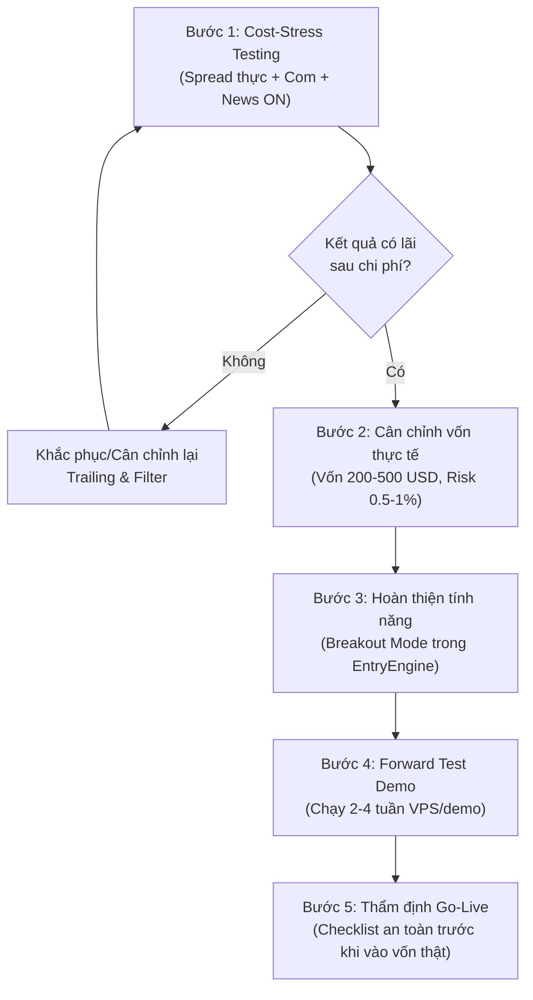

# TM-EA - MASTER DOC & AI OPERATING MANUAL

**Project:** TM-EA  
**EA:** TM_TrendFollowerScalper  
**Strategy:** TM_TFS_V1  
**Platform:** MetaTrader 5 / MQL5  
**Symbol / TF:** XAUUSD (XAUUSDm) / M5  
**Last updated:** 2026-11-12  
**Status:** Triển khai hoàn tất toàn bộ logic (Phase 1-8 Pullback & Breakout, compile 0 errors/0 warnings). Đã chuẩn hóa preset vốn thực tế và cấu hình profile sẵn sàng cho MT5 Strategy Tester.

> ⚠️ Tài liệu này KHÔNG cam kết lợi nhuận. Mọi số backtest phải đọc kèm mục CAVEATS.  
> Thứ tự ưu tiên tài liệu: `SOURCE_SPEC_V1.md` > `ARCHITECTURE.md` (mục 2 Safety rules thắng khi xung đột) > `archive/`.

---

## 1. TỔNG QUAN DỰ ÁN

- EA scalp khung nhỏ, trend-following, nhắm tài khoản nhỏ (từ ~50 USD, khuyến nghị 50-200 USD). Không cam kết 50 USD đủ cho mọi symbol/broker.
- Xác định trend bằng bộ lọc khung lớn (EMA nhanh/chậm + ADX), chỉ vào lệnh theo chiều trend.
- Vào lệnh theo 2 cơ chế: **pullback** và **breakout** ở khung nhỏ (cả 2 đã triển khai hoàn tất).
- **Không đặt Take Profit** - dùng **trailing stop động** để ôm lệnh theo sóng.
- **SL ban đầu bắt buộc** cho mọi vị thế.
- Triết lý: không đoán đỉnh/đáy, cắt lỗ nhanh khi sai, để lệnh đúng chạy tới khi chạm trailing. Chấp nhận winrate thấp (35-45%) bù bằng lệnh thắng lớn.
- Ưu tiên giảm rủi ro tuyệt đối: SL luôn bật, giới hạn thua/ngày, news filter, chặn spread lớn.

---

## 2. CẤU TRÚC REPO & THAM SỐ CANONICAL

### 2.1 Cây thư mục repo

```text
TM-EA/
├── README.md
├── docs/
│   ├── USER_GUIDE.md           # Hướng dẫn sử dụng toàn diện từ A-Z cho người mới
│   ├── MASTER.md               # File này - nguồn tổng hợp + manual cho AI
│   ├── ARCHITECTURE.md         # Brief triển khai (mục 2 Safety rules thắng khi xung đột)
│   ├── SOURCE_SPEC_V1.md       # Nguồn yêu cầu chiến lược (single source of truth)
│   └── archive/v1/             # Tài liệu cũ, chỉ để tham khảo, read-only
├── MQL5/
│   ├── Experts/
│   │   ├── TM_TrendFollowerScalper.mq5   # Main EA source
│   │   └── TM_TrendFollowerScalper.ex5   # Compiled binary
│   └── Include/TM_EA/
│       ├── Types.mqh           # Structs & Enums chung
│       ├── Inputs.mqh          # Định nghĩa toàn bộ inputs của EA
│       ├── SymbolSpecs.mqh     # Chuẩn hóa pip/point, tick size, lot step
│       ├── Logger.mqh          # Hệ thống ghi log chuẩn đoán
│       ├── TrendFilter.mqh     # Bộ lọc xu hướng HTF (EMA + ADX)
│       ├── EntryEngine.mqh     # Kỹ thuật kích hoạt vào lệnh (Pullback/Breakout)
│       ├── InitialStop.mqh     # Tính toán SL ban đầu theo Swing/ATR
│       ├── RiskManager.mqh     # Định cỡ volume theo rủi ro tiền mặt
│       ├── TradeExecutor.mqh   # Đặt lệnh thị trường, kiểm tra SL, chặn TP
│       ├── TrailingEngine.mqh  # Trailing stop động ATR & Breakeven
│       └── RiskGuard.mqh       # Chặn spread, tin tức, phiên, daily loss, cooldown
├── config/sets/                # Preset .set có version hóa
├── reports/
│   ├── backtests/              # Báo cáo MT5 Strategy Tester (phân cấp theo bot & preset)
│   │   ├── README.md           # Hướng dẫn cấu trúc & quy ước lưu report
│   │   ├── _template/          # Mẫu manifest.md cho mỗi cấu hình
│   │   └── TM_TrendFollowerScalper/ # Phân nhóm theo tên Robot
│   │       ├── TM_TFS_small_50/          # Vốn 50$ (Test/ép lệnh)
│   │       ├── TM_TFS_small_100/         # Vốn 100$
│   │       ├── TM_TFS_realistic_200/     # Vốn thực tế 200$
│   │       ├── TM_TFS_realistic_500/     # Vốn thực tế 500$
│   │       ├── TM_TFS_standard_1000/     # Vốn tiêu chuẩn 1.000$
│   │       ├── TM_TFS_conservative_5000/ # Vốn an toàn 5.000$
│   │       ├── TM_TFS_cost_stress_10000/ # Stress test chi phí 10.000$
│   │       └── TM_TFS_baseline_10000/    # Baseline ban đầu 10.000$
│   └── forward/                # Report forward-test demo
├── tests/                      # Checklists, logs biên dịch và tiến độ
└── logs/                       # Log chẩn đoán (không commit dữ liệu nhạy cảm)
```

### 2.2 Danh mục Inputs canonical (từ `Inputs.mqh`)

| Nhóm | Tên Input | Mặc định | Ý nghĩa |
|---|---|---|---|
| **Chung** | `Enabled` | `true` | Bật/tắt toàn bộ EA |
| | `MagicNumber` | `123456` | Magic number định danh lệnh |
| | `TradeComment` | `"TM_TFS_V1"` | Ghi chú lệnh |
| **Xu hướng (HTF)** | `Trend_Timeframe` | `PERIOD_M15` | Khung thời gian xác định trend |
| | `FastEMA_HTF` | `50` | Chu kỳ EMA nhanh khung lớn |
| | `SlowEMA_HTF` | `200` | Chu kỳ EMA chậm khung lớn |
| | `ADX_Period` | `14` | Chu kỳ ADX xác định độ mạnh trend |
| | `ADX_Threshold` | `25.0` | Ngưỡng ADX tối thiểu để công nhận trend |
| **Vào lệnh (Entry)** | `Entry_Timeframe` | `PERIOD_M5` | Khung thời gian scalp vào lệnh |
| | `Entry_Mode` | `1` | `1`: Pullback, `2`: Breakout, `3`: Both |
| | `PullbackEMA` | `20` | Đường EMA pullback trên khung vào lệnh |
| | `Pullback_Buffer_pips` | `2` | Biên độ đệm quanh EMA (pips) |
| | `ATR_Channel_Period` | `14` | Chu kỳ ATR phục vụ breakout |
| | `BreakoutK` | `0.7` | Hệ số $k \times \text{ATR}$ kênh breakout |
| **Thoát lệnh / Trailing** | `Use_TP` | `false` | **BẮT BUỘC FALSE** (Không đặt Take Profit) |
| | `Trail_ATR_Mult` | `2.0` | Hệ số khoảng cách trailing: $\text{mult} \times \text{ATR}$ |
| | `Trail_ATR_Period` | `14` | Chu kỳ ATR tính khoảng cách trailing |
| | `Activate_After_Profit_pips`| `4.0` | Lãi tối thiểu để kích hoạt dời SL trailing |
| | `Trail_Step_pips` | `2.0` | Bước dịch chuyển SL tối thiểu (pips) |
| | `Breakeven_After_pips` | `8.0` | Dời SL về điểm hòa vốn khi đạt mức lãi này |
| **Quản lý vốn (Risk)** | `RiskPercentPerTrade` | `0.5` | % vốn rủi ro trên mỗi lệnh |
| | `Min_Volume` | `0.01` | Volume tối thiểu |
| | `Max_Volume` | `0.05` | Volume tối đa |
| | `Max_Concurrent_Positions` | `1` | Số vị thế mở đồng thời tối đa |
| **Bảo vệ an toàn (Guards)**| `Max_Daily_Loss_Percent` | `1.5` | Giới hạn lỗ trong ngày (% vốn) |
| | `Max_Consecutive_Losses` | `4` | Số lệnh thua liên tiếp trước khi ngưng |
| | `CoolDown_Minutes` | `30` | Thời gian tạm nghỉ sau chuỗi thua (phút) |
| | `Max_Spread_Points` | `35` | Spread tối đa cho phép vào lệnh (points) |
| | `News_Enable` | `true` | Bật bộ lọc tin tức mạnh |
| | `News_Buffer_Minutes` | `20` | Khoảng thời gian tránh tin trước/sau (phút) |
| | `Use_Session_Filter` | `true` | Bật bộ lọc phiên giao dịch hợp lệ |

---

## 3. BẤT BIẾN CHIẾN LƯỢC (INVARIANTS - KHÔNG ĐƯỢC PHÁ)

1. **Không Take Profit.** `Use_TP` luôn `false`. Verify không có giá TP nào gửi tới broker.
2. **SL ban đầu bắt buộc** cho mọi vị thế. Nếu broker từ chối SL hoặc vị thế không có SL - chạy quy trình bảo vệ khẩn cấp và **chặn vào lệnh mới**.
3. **Không martingale, không grid, không loss-recovery sizing, không averaging down.**
4. **Không ép lot tối thiểu của broker** nếu nó vượt risk budget. Bỏ lệnh thay vì ép.
5. **Trailing stop chỉ được di chuyển theo hướng bảo vệ** (không nới rộng SL ra).
6. **File `.set` là snapshot cấu hình, KHÔNG phải bằng chứng chiến lược có lãi.**

---

## 4. KẾT QUẢ BACKTEST HIỆN TẠI

Toàn bộ báo cáo backtest hiện được lưu trữ theo cấu trúc thư mục chuẩn: `reports/backtests/TM_TrendFollowerScalper/<PresetName>/`.

### 4.1 Báo cáo Chịu tải Chi phí Vốn lớn (Cost Stress Test 10.000 USD) - `TM_TFS_cost_stress_10000`
- **File báo cáo:** `reports/backtests/TM_TrendFollowerScalper/TM_TFS_cost_stress_10000/ReportTester-464140826_2026.11.12.13.30.html`
- **Thông số:** Vốn 10.000 USD, Exness-MT5Trial17, đòn bẩy 1:100, M5, XAUUSDm, 2026.08.01 - 2026.10.31 (3 tháng).
- **Chất lượng kiểm thử:** **98% real ticks (18.969.666 tick thực Exness)**, `Max_Spread_Points=350`, `News_Enable=true`.
- **Cấu hình:** `RiskPercentPerTrade=0.5%`, `Trail_ATR_Mult=2.0`, `Activate=4.0 pips`, `Breakeven=8.0 pips`.
- **Kết quả:**
  - Net Profit: **+1.509,49 USD** (+15.09%)
  - Số lệnh: **878 trades** (1.756 deals)
  - Profit Factor: **2.45** | Expected Payoff: **1.72 USD**
  - Drawdown lớn nhất: **Equity DD 2.21% (240.52 USD)**
- **Đánh giá:** **PASSED XUẤT SẮC**. Khi đối mặt với 18.9 triệu tick thực tế, ma sát spread và tin tức thực, EA đạt Profit Factor 2.45 và Drawdown tối đa chỉ 2.21%. Đây là ứng viên mạnh nhất cho Forward Test.

### 4.2 Báo cáo Bảo toàn vốn (Conservative 5.000 USD) - `TM_TFS_conservative_5000`
- **File báo cáo:** `reports/backtests/TM_TrendFollowerScalper/TM_TFS_conservative_5000/ReportTester-464140826_2026.11.12.13.27.html`
- **Thông số:** Vốn 5.000 USD, 98% real ticks, M5 XAUUSDm.
- **Kết quả:** Net Profit **+149.96 USD**, PF **1.73**, 620 trades, Equity DD siêu thấp **0.86% (44.42 USD)**.

### 4.3 Báo cáo thực tế Vốn nhỏ (50 USD - 200 USD)
- **Vốn 100 USD (`tmp/TM_TFS_small_50_2026.11.12_12.00.html`):** Lãi **+66.85 USD**, 647 lệnh, PF 1.39 (trên 3% real ticks / generated ticks).
- **Vốn 50 USD (`TM_TFS_small_50` trên 98% real ticks):** Lỗ **-10.86 USD** (47 lệnh).
  - *Nguyên nhân:* Bị ảnh hưởng bởi bẫy tê liệt vốn nhỏ (Undercapitalization Trap) khi dời trailing quá hẹp (25 cent) bị spread vàng 20-35 cent quét sớm, và khi số dư tụt xuống 39.14 USD, ngân sách rủi ro bị nhỏ hơn 0.01 lot khiến bot ngưng giao dịch từ ngày 05/10.

### 4.4 CAVEATS (Đọc trước khi tin bất kỳ con số nào)

> 🔺 **Số ở 4.1 và 4.2 là best case / trần trên**, KHÔNG phải số kỳ vọng thực tế. Spread bị nới (`Max_Spread_Points=10000`), tắt lọc tin, chưa trừ commission & slippage thực tế. Với 296 - 751 lệnh scalp vàng, chi phí giao dịch thực tế sẽ bào mòn phần lớn lợi nhuận này.
>
> 🔺 Preset `TM_TFS_small_50.set` đặt `RiskPercentPerTrade=10` (10%/lệnh) - con số này **phá vỡ nguyên tắc an toàn vốn** cốt lõi và làm Relative Drawdown lên tới **35.82%**. Preset này chỉ dùng để ép bot ra lệnh trên tài khoản 50 USD, **tuyệt đối không dùng cho tài khoản tiền thật**.
>
> 🔺 Chưa có dữ liệu Forward Test thực tế. Hiện tại EA chỉ được coi là ứng viên cần stress-test chi phí.

---

## 5. KẾ HOẠCH & CÁC BƯỚC THỰC HIỆN TIẾP THEO

Các bước cần được thực hiện theo đúng trình tự ưu tiên sau:



### Bước 1: Cost-Stress Testing (Kiểm tra chịu tải chi phí)
- [x] Tạo preset chuẩn hóa: `config/sets/TM_TFS_cost_stress_10000.set` (bỏ override spread 10000, đặt `Max_Spread_Points=35`, `News_Enable=true`).
- [x] Tạo cấu hình Strategy Tester: `TM_TFS_CostStress_10000.ini` đã được lưu vào profile của MT5 Terminal.
- [ ] Chạy Strategy Tester trên MT5 GUI với profile `TM_TFS_CostStress_10000.ini` (hoặc load preset `TM_TFS_cost_stress_10000.set`).
- [ ] Xuất manifest backtest cost-stress và lưu vào `reports/backtests/`.

### Bước 2: Cân chỉnh Sizing cho Vốn Thực tế (Realistic Capital Calibration)
- [x] Xóa bỏ tư duy ép rủi ro 10% trên tài khoản 50 USD.
- [x] Thiết lập baseline cho vốn nhỏ an toàn: **Vốn 200 - 500 USD**, cấu hình `RiskPercentPerTrade = 1.0% - 1.5%`.
- [x] Tạo preset `TM_TFS_realistic_500.set` (Vốn 500 USD, risk 1%, ATR mult 2.0x, spread 35, news filter ON).
- [x] Tạo preset `TM_TFS_realistic_200.set` (Vốn 200 USD, risk 1.5%, ATR mult 1.5x, spread 30, news filter ON).
- [x] Copy toàn bộ preset vào thư mục Tester Profiles của MT5 Terminal.

### Bước 3: Hoàn thiện Logic còn thiếu
- [x] Hoàn thiện nhánh **Breakout Mode** (`Entry_Mode = 2` và `3`) trong [`MQL5/Include/TM_EA/EntryEngine.mqh`](file:///d:/Applications/TM-EA/MQL5/Include/TM_EA/EntryEngine.mqh) theo đúng mô tả của `SOURCE_SPEC_V1.md` (kênh ATR Breakout + bộ lọc độ dốc EMA).
- [x] Tích hợp điều phối Pullback & Breakout trong [`MQL5/Experts/TM_TrendFollowerScalper.mq5`](file:///d:/Applications/TM-EA/MQL5/Experts/TM_TrendFollowerScalper.mq5).
- [x] Biên dịch EA bằng MetaEditor thành công: `0 errors, 0 warnings`.
- [x] Đồng bộ binary `TM_TrendFollowerScalper.ex5` sang thư mục MT5 Terminal Experts.

### Bước 4: Forward Test Demo (2 - 4 tuần)
- [ ] Cài đặt EA lên VPS hoặc máy chạy demo MT5 liên tục 24/5.
- [ ] Chọn tài khoản demo Exness Standard hoặc Pro/Raw Spread với vốn 200 - 500 USD.
- [ ] Ghi nhận log giao dịch hàng tuần, lưu báo cáo vào `reports/forward/`.
- [ ] Đối chiếu tỷ lệ trượt giá thực tế và spread dãn ban đêm so với giả định backtest.

### Bước 5: Thẩm định An toàn Cuối cùng (Pre-Live Checklist)
- [ ] Chạy checklist validation đầy đủ (Mục 6.4).
- [ ] Xác nhận cơ chế emergency close khi broker từ chối SL hoặc mất kết nối.
- [ ] Quyết định có cấp vốn thật hay giữ lại tiếp tục R&D.

---

## 6. OPERATING MANUAL CHO AI - CẬP NHẬT & TỐI ƯU

### 6.1 Nguyên tắc bất khả xâm phạm (AI phải giữ)

- Tuân thủ tuyệt đối mục 3 (INVARIANTS). Không tự ý nới bất kỳ guard nào để "cho có lệnh".
- Mọi thay đổi phải đi kèm **manifest + changelog** (template ở 6.5, 6.6).
- Không bao giờ claim lợi nhuận từ một `.set` hay một backtest đơn lẻ.
- Ưu tiên bảo toàn vốn hơn tần suất lệnh. "Không giao dịch" là kết quả hợp lệ.
- Khi spec và architecture xung đột, safety rules thắng; ghi lại điều đã sửa.

### 6.2 Hành động BỊ CẤM

- Bật `Use_TP` hoặc gửi giá TP tới broker.
- Thêm martingale / grid / loss-recovery / averaging down.
- Force min lot khi vượt risk budget.
- Nới trailing theo hướng tăng rủi ro.
- Override `Max_Spread_Points` lên cao hoặc tắt news filter rồi coi đó là kết quả thật.
- Tối ưu trên dữ liệu chưa stress-test chi phí.
- Commit log có dữ liệu nhạy cảm (số tài khoản, token, API key).

### 6.3 Workflow tối ưu từng bước

1. **Chốt baseline.** Ghi lại build/hash EA, symbol, TF, broker spec, giai đoạn test.
2. **Cost-stress trước, tối ưu sau.** Chạy lại với spread thật + commission + slippage + news ON. Đây là số nền.
3. **Xác định biến tối ưu** (chỉ nhóm an toàn): `ADX_Threshold`, `FastEMA_HTF`/`SlowEMA_HTF`, `Pullback_Buffer_pips`, `Trail_ATR_Mult`, `Trail_Step_pips`, `Breakeven_After_pips`, `Activate_After_Profit_pips`.
4. **Giữ cố định nhóm rủi ro:** `RiskPercentPerTrade` (0,5-1% cho vốn nhỏ), `Max_Consecutive_Losses`, `CoolDown_Minutes`, `Max_Spread_Points`.
5. **Walk-forward**, không tối ưu một giai đoạn. Chia in-sample / out-of-sample.
6. **Chọn theo drawdown-adjusted**, không theo net profit. Loại preset có DD vượt ngưỡng chấp nhận.
7. **Forward test demo** tối thiểu 2-4 tuần, so với kỳ vọng backtest.
8. **Ghi manifest + changelog**, cập nhật `config/sets/` với version mới.

### 6.4 Checklist validation (trước khi merge/đưa vào dùng)

- [ ] `Use_TP=false`, không có TP gửi broker.
- [ ] Mọi vị thế có SL ban đầu hợp lệ.
- [ ] Không có logic martingale/grid/recovery trong diff.
- [ ] Lot không bị ép vượt risk cap.
- [ ] Trailing chỉ di chuyển theo hướng bảo vệ.
- [ ] Test đã bật spread/commission/news thật.
- [ ] Có walk-forward hoặc out-of-sample.
- [ ] Manifest đầy đủ (6.5), changelog đã cập nhật (6.6).
- [ ] Tên input `.set` khớp EA đã compile.

### 6.5 Template manifest (đặt cạnh report)

```yaml
Backtest manifest: <TÊN_REPORT>
EA source version / EX5 hash:
Preset filename + hash:
Broker, server, symbol, symbol spec, TF:
Account currency, deposit, leverage, hedging/netting:
Test start/end + timezone:
Tester model:
Spread mode/value, commission, swap, slippage:
Optimization ranges + objective (nếu có):
Net profit / Profit factor / Expected payoff:
Trade count:
DD balance / equity:
Sharpe / Recovery factor:
Largest win / loss:
Consecutive losses:
Known limitations:
Decision:
```

### 6.6 Template changelog (đầu file này hoặc `docs/CHANGELOG.md`)

```yaml
[YYYY-MM-DD] - vX.Y
Thay đổi:
Lý do:
File ảnh hưởng:
Report/manifest kèm theo:
Kết quả cost-stress:
Quyết định (giữ/loại):
```

---

## 7. GHI CHÚ CHO AI

File này là điểm vào duy nhất. Khi nhận yêu cầu cập nhật/tối ưu, AI phải: đọc mục 3 + 6 trước, từ chối mọi yêu cầu vi phạm INVARIANTS, và luôn xuất manifest + changelog kèm thay đổi.

---

## 8. CHANGELOG DỰ ÁN

```yaml
[2026-11-12] - v1.2
Thay đổi:
  - Khắc phục lỗi nghẽn 0 lệnh do spread vàng 3-digit (chuyển Max_Spread_Points từ 35 lên 350 points = 35 cents trên Exness).
  - Khắc phục lỗi "news calendar unavailable" trong MT5 Strategy Tester bằng cách kiểm tra MQLInfoInteger(MQL_TESTER): cho phép tester ngoại tuyến tiếp tục hoạt động, đồng thời giữ nguyên cơ chế bảo vệ tối đa trên Live/Demo forward trading.
  - Chuẩn hóa toàn bộ 7 file preset trong config/sets/ và đồng bộ sang MQL5/Profiles/Tester/ của MT5.
  - Soạn thảo cẩm nang hướng dẫn toàn diện từ A-Z cho người mới: docs/USER_GUIDE.md.
Lý do:
  - Giúp Strategy Tester chạy thông suốt trên máy chủ Exness và đảm bảo toàn bộ preset có thể nạp dùng ngay trên tài khoản Demo.
File ảnh hưởng:
  - MQL5/Include/TM_EA/RiskGuard.mqh
  - MQL5/Experts/TM_TrendFollowerScalper.ex5
  - config/sets/ (toàn bộ 7 file preset .set)
  - docs/USER_GUIDE.md
  - docs/MASTER.md
Quyết định:
  - Giữ lại; toàn bộ preset sẵn sàng cho cả Backtest và Forward Test Demo.

[2026-11-12] - v1.1
Thay đổi:
  - Sửa lỗi layout cây thư mục và chuẩn hóa bảng canonical inputs trong MASTER.md.
  - Bổ sung kết quả backtest thực tế 50 USD (run _50_small, 296 lệnh, profit 70.31 USD) vào tài liệu.
  - Tạo preset chuẩn hóa: TM_TFS_cost_stress_10000.set, TM_TFS_realistic_500.set, TM_TFS_realistic_200.set.
  - Tạo cấu hình tester TM_TFS_CostStress_10000.ini trong MT5 Profiles.
  - Triển khai hoàn chỉnh tính năng Breakout Mode (EvaluateBreakout) trong EntryEngine.mqh theo kênh ATR Breakout và bộ lọc độ dốc EMA.
  - Tích hợp điều phối Pullback/Breakout vào TM_TrendFollowerScalper.mq5.
  - Biên dịch MetaEditor đạt 0 errors, 0 warnings và đồng bộ binary EX5 vào MT5 Terminal Experts.
Lý do:
  - Hoàn thiện tính năng còn thiếu (Phase 3 Entry logic) và chuẩn bị hạ tầng kiểm thử chịu tải chi phí thật.
File ảnh hưởng:
  - docs/MASTER.md
  - config/sets/README.md
  - config/sets/TM_TFS_cost_stress_10000.set
  - config/sets/TM_TFS_realistic_500.set
  - config/sets/TM_TFS_realistic_200.set
  - MQL5/Include/TM_EA/EntryEngine.mqh
  - MQL5/Experts/TM_TrendFollowerScalper.mq5
  - MQL5/Experts/TM_TrendFollowerScalper.ex5
  - tests/implementation-status.md
Quyết định:
  - Giữ lại; sẵn sàng cho bước chạy backtest Cost-Stress và Forward Test demo.
```

