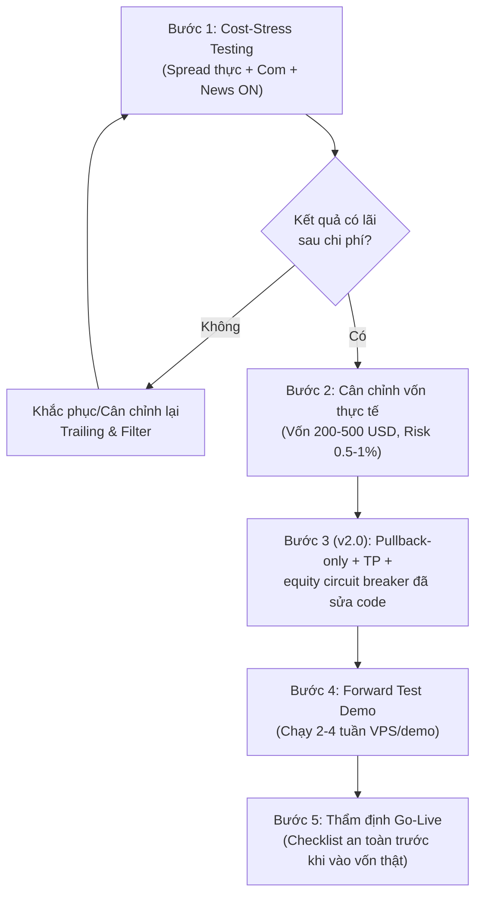

# TM-EA - MASTER DOC & AI OPERATING MANUAL

**Project:** TM-EA  
**EA:** TM_TrendFollowerScalper  
**Strategy:** TM_TFS_V1  
**Platform:** MetaTrader 5 / MQL5  
**Symbol / TF:** XAUUSD (XAUUSDm) / M5  
**Last updated:** 2026-11-12 (v2.0 strategy change)  
**Status:** **v3.1** — chiến lược trend cũ thua 6/6 vòng; **EA `TM_SessionBreakout` (range-breakout H1) + lọc ADX(H1)** là **kết quả ổn định nhất của dự án**: 3Y PF **1.665**, DD **7.9%**; walk-forward **3/3 năm dương** (W1 1.03 / W2 2.69 / W3 1.50); plateau RR4–6. **NHƯNG chưa xác nhận** (commission=0, mẫu nhỏ, fail EURUSD) → **không chạy tiền thật**; bước bắt buộc tiếp theo là test có phí. Đóng: BUG-006/013. Mở: BUG-002/003/004/007/008. Xem `reports/backtests/_sb/SB_RESEARCH.md`, `CHANGELOG.md` (v3.1).

> ⚠️ Tài liệu này KHÔNG cam kết lợi nhuận. Mọi số backtest phải đọc kèm mục CAVEATS.  
> Thứ tự ưu tiên tài liệu: `SOURCE_SPEC_V1.md` > `ARCHITECTURE.md` (mục 2 Safety rules thắng khi xung đột) > `archive/`.  
> Audit kỹ thuật & bằng chứng: `TECHNICAL_AUDIT.md` (P1), `SOURCE_REPORT_CONSISTENCY.md` (P0), `CHANGELOG.md`.

---

## 1. TỔNG QUAN DỰ ÁN

- EA scalp khung nhỏ, trend-following, nhắm tài khoản nhỏ (từ ~50 USD, khuyến nghị 50-200 USD). Không cam kết 50 USD đủ cho mọi symbol/broker.
- Xác định trend bằng bộ lọc khung lớn (EMA nhanh/chậm + ADX), chỉ vào lệnh theo chiều trend.
- Vào lệnh theo **pullback** ở khung nhỏ (v2.0: Breakout đã bị bỏ).
- **Có Take Profit** (v2.0, `Use_TP=true`, `TP_ATR_Mult`) kết hợp **trailing stop động**. Trước v2.0 chiến lược không có TP.
- **SL ban đầu bắt buộc** cho mọi vị thế.
- Triết lý: không đoán đỉnh/đáy, cắt lỗ nhanh khi sai, để lệnh đúng chạy tới khi chạm trailing. Chấp nhận winrate thấp (35-45%) bù bằng lệnh thắng lớn.
- Ưu tiên giảm rủi ro tuyệt đối: SL luôn bật, giới hạn thua/ngày, news filter, chặn spread lớn.

---

## 2. CẤU TRÚC REPO & THAM SỐ CANONICAL

### 2.1 Cây thư mục repo

```text
TM-EA/
├── README.md
├── docs/
│   ├── USER_GUIDE.md           # Hướng dẫn sử dụng toàn diện từ A-Z cho người mới
│   ├── MASTER.md               # File này - nguồn tổng hợp + manual cho AI
│   ├── ARCHITECTURE.md         # Brief triển khai (mục 2 Safety rules thắng khi xung đột)
│   ├── SOURCE_SPEC_V1.md       # Nguồn yêu cầu chiến lược (single source of truth)
│   ├── TECHNICAL_AUDIT.md      # P1: audit copy/shift/news/filling/riskguard
│   ├── SOURCE_REPORT_CONSISTENCY.md # P0: đối chiếu MASTER ↔ source ↔ report
│   ├── CHANGELOG.md            # Lịch sử thay đổi (định dạng §6.6)
│   └── archive/v1/             # Tài liệu cũ, chỉ để tham khảo, read-only
├── MQL5/
│   ├── Experts/
│   │   ├── TM_TrendFollowerScalper.mq5   # Main EA source (trend-following; 6 vòng tối ưu đều gãy OOS)
│   │   ├── TM_TrendFollowerScalper.ex5   # Compiled binary
│   │   ├── TM_SessionBreakout.mq5        # [v3.0] EA nghiên cứu mới: range-breakout theo phiên (H1)
│   │   └── TM_SessionBreakout.ex5        # Compiled binary
│   └── Include/TM_EA/
│       ├── Types.mqh           # Structs & Enums chung
│       ├── Inputs.mqh          # Định nghĩa toàn bộ inputs của EA
│       ├── SymbolSpecs.mqh     # Chuẩn hóa pip/point, tick size, lot step
│       ├── Logger.mqh          # Hệ thống ghi log chuẩn đoán
│       ├── TrendFilter.mqh     # Bộ lọc xu hướng HTF (EMA + ADX)
│       ├── EntryEngine.mqh     # Kỹ thuật kích hoạt vào lệnh (Pullback; Breakout đã bỏ ở v2.0)
│       ├── InitialStop.mqh     # Tính toán SL ban đầu theo Swing/ATR
│       ├── RiskManager.mqh     # Định cỡ volume theo rủi ro tiền mặt
│       ├── TradeExecutor.mqh   # Đặt lệnh thị trường, kiểm tra SL, chặn TP
│       ├── TrailingEngine.mqh  # Trailing stop động ATR & Breakeven
│       └── RiskGuard.mqh       # Chặn spread, tin tức, phiên, daily loss, cooldown
├── config/sets/                # Preset .set có version hóa
├── reports/
│   ├── backtests/              # Báo cáo MT5 Strategy Tester (phân cấp theo bot & preset)
│   │   ├── README.md           # Hướng dẫn cấu trúc & quy ước lưu report
│   │   ├── _template/          # Mẫu manifest.md cho mỗi cấu hình
│   │   └── TM_TrendFollowerScalper/ # Phân nhóm theo tên Robot
│   │       ├── TM_TFS_small_50/          # Vốn 50$ (Test/ép lệnh)
│   │       ├── TM_TFS_small_100/         # Vốn 100$
│   │       ├── TM_TFS_realistic_200/     # Vốn thực tế 200$
│   │       ├── TM_TFS_realistic_500/     # Vốn thực tế 500$
│   │       ├── TM_TFS_standard_1000/     # Vốn tiêu chuẩn 1.000$
│   │       ├── TM_TFS_conservative_5000/ # Vốn an toàn 5.000$
│   │       ├── TM_TFS_cost_stress_10000/ # Stress test chi phí 10.000$
│   │       └── TM_TFS_baseline_10000/    # Baseline ban đầu 10.000$
│   └── forward/                # Report forward-test demo
├── tests/                      # Checklists, logs biên dịch và tiến độ
└── logs/                       # Log chẩn đoán (không commit dữ liệu nhạy cảm)
```

### 2.2 Danh mục Inputs canonical (từ `Inputs.mqh`)

| Nhóm | Tên Input | Mặc định | Ý nghĩa |
|---|---|---|---|
| **Chung** | `Enabled` | `true` | Bật/tắt toàn bộ EA |
| | `MagicNumber` | `123456` | Magic number định danh lệnh |
| | `TradeComment` | `"TM_TFS_V1"` | Ghi chú lệnh |
| | `Trade_Direction` | `0` | `[v2.3]` 0=Both, 1=Buy only, 2=Sell only |
| **Xu hướng (HTF)** | `Trend_Timeframe` | `PERIOD_M15` | Khung thời gian xác định trend |
| | `FastEMA_HTF` | `50` | Chu kỳ EMA nhanh khung lớn |
| | `SlowEMA_HTF` | `200` | Chu kỳ EMA chậm khung lớn |
| | `ADX_Period` | `14` | Chu kỳ ADX xác định độ mạnh trend |
| | `ADX_Threshold` | `25.0` | Ngưỡng ADX tối thiểu để công nhận trend |
| | `Use_EMA_Slope_Filter` | `true` | `[v2.4]` Yêu cầu độ dốc EMA HTF theo chiều trend |
| | `Require_Close_Beyond_EMA` | `true` | `[v2.4]` Nến pullback phải đóng qua EMA |
| **Vào lệnh (Entry)** | `Entry_Timeframe` | `PERIOD_M5` | Khung thời gian scalp vào lệnh |
| | `PullbackEMA` | `20` | Đường EMA pullback trên khung vào lệnh |
| | `Pullback_Buffer_pips` | `2` | Biên độ đệm quanh EMA (pips) |
| | `Use_Breakout` | `true` | `[v2.1]` Bật Breakout (nếu false: chỉ Pullback) |
| | `BreakoutK` | `0.7` | `[v2.1]` Hệ số k*ATR cho kênh breakout |
| **Thoát lệnh / Trailing** | `Use_TP` | `true` | Bật Take Profit (v2.0) |
| | `TP_ATR_Mult` | `1.5` | Khoảng TP = $\text{mult} \times \text{ATR}$ từ entry |
| | `SL_ATR_Mult` | `1.0` | `[v2.3]` Khoảng SL ban đầu = mult×ATR (tách khỏi trailing) |
| | `Trail_ATR_Mult` | `2.0` | Hệ số khoảng cách trailing: $\text{mult} \times \text{ATR}$ |
| | `Trail_ATR_Period` | `14` | Chu kỳ ATR tính khoảng cách trailing |
| | `Activate_After_Profit_pips`| `4.0` | Lãi tối thiểu để kích hoạt dời SL trailing |
| | `Trail_Step_pips` | `2.0` | Bước dịch chuyển SL tối thiểu (pips) |
| | `Breakeven_After_pips` | `8.0` | Dời SL về điểm hòa vốn khi đạt mức lãi này |
| | `Breakeven_ATR_Mult` | `1.0` | `[v2.2]` Không breakeven trước `mult × ATR` (fix BUG-013) |
| | `Use_Partial_Exit` | `false` | `[v2.5]` Scale-out (mặc định tắt — làm giảm PF) |
| | `Partial_Exit_ATR_Mult` | `1.0` | `[v2.5]` Ngưỡng chốt một phần = mult×ATR |
| | `Partial_Exit_Percent` | `50.0` | `[v2.5]` % volume chốt |
| **Quản lý vốn (Risk)** | `RiskPercentPerTrade` | `0.5` | % vốn rủi ro trên mỗi lệnh |
| | `Min_Volume` | `0.01` | Volume tối thiểu |
| | `Max_Volume` | `0.05` | Volume tối đa |
| | `Max_Concurrent_Positions` | `1` | Số vị thế mở đồng thời tối đa |
| **Bảo vệ an toàn (Guards)**| `Max_Equity_DD_Percent` | `10.0` | Circuit breaker: DD equity từ baseline ngày ≥ ngưỡng → đóng hết + khóa trong ngày |
| | `Max_Daily_Loss_Percent` | `1.5` | Giới hạn lỗ trong ngày (% vốn) |
| | `Max_Consecutive_Losses` | `4` | Số lệnh thua liên tiếp trước khi ngưng |
| | `CoolDown_Minutes` | `30` | Thời gian tạm nghỉ sau chuỗi thua (phút) |
| | `Max_Spread_Points` | `35` | Spread tối đa cho phép vào lệnh (points) |
| | `News_Enable` | `true` | Bật bộ lọc tin tức mạnh |
| | `News_Buffer_Minutes` | `20` | Khoảng thời gian tránh tin trước/sau (phút) |
| | `Use_Session_Filter` | `true` | Bật bộ lọc phiên giao dịch hợp lệ |

---

## 3. BẤT BIẾN CHIẾN LƯỢC (INVARIANTS - KHÔNG ĐƯỢC PHÁ)

1. ~~**Không Take Profit.** `Use_TP` luôn `false`.~~ **[v2.0 — ĐÃ THAY ĐỔI]** Take Profit được bật mặc định (`Use_TP=true`, `TP_ATR_Mult`). Đây là quyết định của chủ dự án ngày 2026-11-12; tài liệu và spec đã cập nhật. Khi `Use_TP=true`, phải xác minh TP luôn nằm đúng phía (trên entry cho BUY, dưới entry cho SELL).
2. **SL ban đầu bắt buộc** cho mọi vị thế. Nếu broker từ chối SL hoặc vị thế không có SL - chạy quy trình bảo vệ khẩn cấp và **chặn vào lệnh mới**.
3. **Không martingale, không grid, không loss-recovery sizing, không averaging down.**
4. **Không ép lot tối thiểu của broker** nếu nó vượt risk budget. Bỏ lệnh thay vì ép.
5. **Trailing stop chỉ được di chuyển theo hướng bảo vệ** (không nới rộng SL ra).
6. **File `.set` là snapshot cấu hình, KHÔNG phải bằng chứng chiến lược có lãi.**
7. **[v2.0] Circuit breaker bắt buộc bật.** Khi DD equity từ baseline ngày ≥ `Max_Equity_DD_Percent`, EA phải đóng toàn bộ vị thế và khóa mở lệnh mới tới hết ngày (persist qua restart).

---

## 4. KẾT QUẢ BACKTEST HIỆN TẠI (đã audit — v1.3)

> ⚠️ **Toàn bộ §4 thuộc build TRƯỚC v2.0 (no-TP + Breakout) → VÔ HIỆU cho v2.0.** Sau khi sửa code v2.0, phải chạy lại từ đầu. Bản trước tuyên bố cost-stress "PASSED XUẤT SẮC" — tuyên bố đó **đã bị rút lại** vì report cost-stress trùng khít report baseline (BUG-005). Chi tiết: `SOURCE_REPORT_CONSISTENCY.md` §5, `reports/backtests/MANIFEST_INDEX.md`. **Không con số nào dưới đây là bằng chứng chiến lược đã được xác nhận.**

Điều kiện chung của **mọi** run: 3 tháng (`2026.08.01–2026.10.31`), 1 symbol (XAUUSDm), commission = 0, `News_Enable=true` **vô hiệu trong tester** (BUG-004), không OOS/walk-forward, binary EX5 cũ hơn source (BUG-006).

### 4.0 [v2.0 — KẾT QUẢ THỰC THI 2026-11-13] — TẤT CẢ ĐỀU LỖ

Backtest real-tick (Model=4), XAUUSDm M5, 2026.08.01–2026.10.31, commission 0, EX5 `0F50E9E0ADD72C90`, biên dịch `0 errors/0 warnings`.

| Preset | Deposit | Net | PF | Trades | EqDD |
|---|---|---|---|---|---|
| realistic_200 | 200 | −16.30 | 0.162 | 59 | 8.64% |
| realistic_500 | 500 | −4.16 | 0.414 | 47 | 1.94% |
| standard_1000 | 1 000 | −4.24 | 0.404 | 48 | 0.99% |
| conservative_5000 | 5 000 | −146.21 | 0.266 | 511 | 3.02% |
| small_50 | 50 | −7.96 | 0.121 | 26 | **18.40%** |
| cost_stress_10000 | 10 000 | −410.00 | 0.601 | 741 | 6.33% |

Kiểm soát TP (Model=1, Oct 1–15): không-TP PF **3.39** > TP1.5 **2.47** > TP0.2 **2.14** → TP làm giảm kết quả.
**Quyết định: REJECT v2.0 as-is.** Chi tiết & tái lập: `reports/backtests/_v2/V2_BACKTEST_RESULTS.md`, `tests/run_backtest_v2.ps1`.

**v2.1 — Study tối ưu (IS 2026.05–07 / OOS 2026.08–10):** fix **BUG-013 (breakeven)** nâng PF 0.155→0.897 (cải thiện thật); khôi phục Breakout +PF nhỏ; tối ưu ADX dương trên IS (PF 1.08 @ADX20) **gãy trên OOS (PF 0.57)** → overfit, không áp dụng. **Chiến lược vẫn PF < 1.** Chi tiết: `reports/backtests/_v2/OPTIMIZATION_STUDY.md`.

### 4.1 Bảng tổng hợp thực tế (pre-v2.0 — lịch sử)

| Preset | Deposit | Quality | Risk% | Net | PF | Trades | EqDD | Phân loại |
|---|---|---|---|---|---|---|---|---|
| `baseline_10000` | 10 000 | **3% real ticks** | 0.5 | +1 509.49 | 2.45 | 878 | 2.21% | DIAGNOSTIC |
| `cost_stress_10000` | 10 000 | 98% real ticks | 0.5 | +1 509.49 | 2.45 | 878 | 2.21% | **INVALID (trùng baseline)** |
| `conservative_5000` | 5 000 | 98% real ticks | 0.25 | +149.96 | 1.73 | 620 | 0.86% | DIAGNOSTIC |
| `realistic_500` | 500 | **3% real ticks** | 1.0 | +0.80 | 1.09 | 53 | 1.96% | NEGATIVE |
| `realistic_200` | 200 | 98% real ticks | 2.0 | −10.87 | 0.58 | 69 | 8.05% | **FAIL** |
| `small_100` | 100 | 98% real ticks | 3.0 | −9.38 | 0.16 | 44 | 10.35% | **FAIL** |
| `small_50` (.13.50) | 50 | 98% real ticks | 8.0 | −10.86 | 0.15 | 47 | 22.57% | **FAIL** |
| `small_50` (.14.46) | **100** | 98% real ticks | 5.0 | −50.92 | 0.14 | 159 | 51.76% | **FAIL (severe)** |
| `standard_1000` | 1 000 | 98% real ticks | 0.5 | −7.14 | 0.31 | 54 | 1.24% | **FAIL** |
| `tmp` (.12.00) | 100 | **3% real ticks** | 5.0 | +66.85 | 1.39 | 647 | 23.97% | DIAGNOSTIC |

### 4.2 Cost-stress: CHƯA CHẠY HỢP LỆ

- `TM_TFS_cost_stress_10000/ReportTester-…13.30.html` **trùng nội dung** với `TM_TFS_baseline_10000/…13.24.html` (39 690/39 690 dòng, khác duy nhất chuỗi `History Quality`). Không thể là 2 lần chạy độc lập.
- Kể cả tính là thật: `Max_Spread_Points=350` (không phải spread nới), `News_Enable` vô hiệu trong tester, **commission = 0**, không slippage. → **không phải cost-stress**.

### 4.3 Chi tiết report .13.30 (INVALID — chỉ tham chiếu lịch sử)
- **File báo cáo:** `reports/backtests/TM_TrendFollowerScalper/TM_TFS_cost_stress_10000/ReportTester-464140826_2026.11.12.13.30.html`
- **Thông số:** Vốn 10.000 USD, Exness-MT5Trial17, đòn bẩy 1:100, M5, XAUUSDm, 2026.08.01 - 2026.10.31 (3 tháng).
- **Chất lượng kiểm thử:** **98% real ticks (18.969.666 tick thực Exness)**, `Max_Spread_Points=350`, `News_Enable=true`.
- **Cấu hình:** `RiskPercentPerTrade=0.5%`, `Trail_ATR_Mult=2.0`, `Activate=4.0 pips`, `Breakeven=8.0 pips`.
- **Kết quả:**
  - Net Profit: **+1.509,49 USD** (+15.09%)
  - Số lệnh: **878 trades** (1.756 deals)
  - Profit Factor: **2.45** | Expected Payoff: **1.72 USD**
  - Drawdown lớn nhất: **Equity DD 2.21% (240.52 USD)**
- **Đánh giá (RÚT LẠI):** Tuyên bố "PASSED" cũ **SAI**. Report này trùng khít `baseline_10000` (chỉ khác nhãn `History Quality`) → không phải lần chạy độc lập, không phải cost-stress (commission 0, spread cap 350, news vô hiệu trong tester). Xem BUG-005.

### 4.4 Chi tiết lịch sử — Conservative 5.000 USD (`TM_TFS_conservative_5000`)
- **File báo cáo:** `reports/backtests/TM_TrendFollowerScalper/TM_TFS_conservative_5000/ReportTester-464140826_2026.11.12.13.27.html`
- **Thông số:** Vốn 5.000 USD, 98% real ticks, M5 XAUUSDm.
- **Kết quả:** Net Profit **+149.96 USD**, PF **1.73**, 620 trades, Equity DD siêu thấp **0.86% (44.42 USD)**.

#### Vốn nhỏ (50–100 USD)
- **Vốn 100 USD (`tmp/TM_TFS_small_50_2026.11.12_12.00.html`):** Lãi **+66.85 USD**, 647 lệnh, PF 1.39 (trên 3% real ticks / generated ticks).
- **Vốn 50 USD (`TM_TFS_small_50` trên 98% real ticks):** Lỗ **-10.86 USD** (47 lệnh).
  - *Nguyên nhân:* Bị ảnh hưởng bởi bẫy tê liệt vốn nhỏ (Undercapitalization Trap) khi dời trailing quá hẹp (25 cent) bị spread vàng 20-35 cent quét sớm, và khi số dư tụt xuống 39.14 USD, ngân sách rủi ro bị nhỏ hơn 0.01 lot khiến bot ngưng giao dịch từ ngày 05/10.

### 4.5 CAVEATS (Đọc trước khi tin bất kỳ con số nào)

> 🔺 **Không số nào ở §4 là bằng chứng chiến lược có lãi.** Tất cả: 3 tháng, 1 symbol, commission 0, news vô hiệu trong tester, không OOS. Report `.13.30` "98%" trùng khít `baseline_10000` "3%" (BUG-005) → không dùng làm bằng chứng.
>
> 🔺 Preset vốn nhỏ dùng risk cao (`small_50.set` = **5.0%**, run = **8.0%**) — **phá vỡ nguyên tắc an toàn vốn**; chỉ dùng để ép bot ra lệnh; **tuyệt đối không dùng tài khoản thật**. (MASTER bản cũ ghi nhầm 10%.)
>
> 🔺 Chưa có Forward Test. EA hiện là **ứng viên R&D cần sửa bug + chạy cost-stress hợp lệ + OOS**, chưa được xác nhận. Bug mở: `tests/BUG_REPRODUCTIONS.md` (BUG-001…009).

---

## 5. KẾ HOẠCH & CÁC BƯỚC THỰC HIỆN TIẾP THEO

Các bước cần được thực hiện theo đúng trình tự ưu tiên sau:



### Bước 0: Sửa lỗi kỹ thuật trước khi test lại (blockers)
- [ ] BUG-006: Biên dịch lại EX5 sau khi `RiskGuard.mqh` đổi; ghi compile log + hash mới.
- [ ] BUG-001: Quyết định `ATR_Channel_Period` cho breakout (hoặc bỏ input, ghi rõ).
- [ ] BUG-002: Chọn filling mode động từ `SYMBOL_FILLING_MODE`; xử lý retcode/partial.
- [ ] BUG-003: Persist `m_lastProcessedDeal` để consecutive-loss idempotent qua restart.
- [ ] BUG-004: Xây historical news adapter cho Strategy Tester (P1.5).
- [ ] BUG-005/009: Dọn report trùng & sai thư mục (chỉ đổi metadata; giữ file gốc).
- [ ] BUG-007/008: Cân nhắc cộng spread/commission vào sizing và dùng volume thật cho margin check.

### Bước 1: Cost-Stress Testing (Kiểm tra chịu tải chi phí)
- [x] Tạo preset `config/sets/TM_TFS_cost_stress_10000.set` — thực tế đặt `Max_Spread_Points=**350**` (không phải 35), `News_Enable=true`. Commission trong tester = 0 (chưa stress được).
- [x] Tạo cấu hình Strategy Tester: `TM_TFS_CostStress_10000.ini` đã được lưu vào profile của MT5 Terminal.
- [ ] Chạy Strategy Tester trên MT5 GUI với profile `TM_TFS_CostStress_10000.ini` (hoặc load preset `TM_TFS_cost_stress_10000.set`).
- [ ] Xuất manifest backtest cost-stress **hợp lệ** (commission + slippage + news adapter). Report `.13.30` hiện có **KHÔNG hợp lệ** (trùng baseline — BUG-005).

### Bước 2: Cân chỉnh Sizing cho Vốn Thực tế (Realistic Capital Calibration)
- [x] Xóa bỏ tư duy ép rủi ro 10% trên tài khoản 50 USD.
- [x] Thiết lập baseline cho vốn nhỏ an toàn: **Vốn 200 - 500 USD**, cấu hình `RiskPercentPerTrade = 1.0% - 1.5%`.
- [x] Tạo preset `TM_TFS_realistic_500.set` (Vốn 500 USD, risk 1.0%, ATR mult 2.0x, spread **350**, news ON). **Đã test → PF 1.09 (negative).**
- [x] Tạo preset `TM_TFS_realistic_200.set` (Vốn 200 USD, risk **2.0%**, ATR mult 1.5x, spread **350**, news ON). **Đã test → PF 0.58 (FAIL).**
- [x] Copy toàn bộ preset vào thư mục Tester Profiles của MT5 Terminal.

### Bước 3: Hoàn thiện Logic — v2.0 (STRATEGY CHANGE)
- [x] **Bỏ Breakout**: xóa `EvaluateBreakout`, `Entry_Mode`, `BreakoutK`, `ATR_Channel_Period`, enum `ENUM_ENTRY_MODE`, `SETUP_BREAKOUT`. Entry chỉ còn Pullback.
- [x] **Bật Take Profit**: `Use_TP=true`, thêm `TP_ATR_Mult=1.5`; truyền TP khi mở lệnh; bỏ chặn `INIT_FAILED`.
- [x] **Thêm circuit breaker**: `Max_Equity_DD_Percent=10.0` + `CloseAllPositions`.
- [x] **Sửa breakeven 2 nhánh** (BUG-010).
- [x] Đồng bộ 8 preset `config/sets/`.
- [ ] (cũ) Biên dịch EA bằng MetaEditor `0 errors, 0 warnings` — **CHƯA chạy lại sau v2.0** (xem Bước 0).
- [ ] ~~Đồng bộ binary `TM_TrendFollowerScalper.ex5`~~ — **CHƯA hợp lệ**: EX5 cũ hơn `RiskGuard.mqh` (BUG-006). Cần biên dịch lại + cập nhật hash + compile log.

### Bước 4: Forward Test Demo (2 - 4 tuần)
- [ ] Cài đặt EA lên VPS hoặc máy chạy demo MT5 liên tục 24/5.
- [ ] Chọn tài khoản demo Exness Standard hoặc Pro/Raw Spread với vốn 200 - 500 USD.
- [ ] Ghi nhận log giao dịch hàng tuần, lưu báo cáo vào `reports/forward/`.
- [ ] Đối chiếu tỷ lệ trượt giá thực tế và spread dãn ban đêm so với giả định backtest.

### Bước 5: Thẩm định An toàn Cuối cùng (Pre-Live Checklist)
- [ ] Chạy checklist validation đầy đủ (Mục 6.4).
- [ ] Xác nhận cơ chế emergency close khi broker từ chối SL hoặc mất kết nối.
- [ ] Quyết định có cấp vốn thật hay giữ lại tiếp tục R&D.

---

## 6. OPERATING MANUAL CHO AI - CẬP NHẬT & TỐI ƯU

### 6.1 Nguyên tắc bất khả xâm phạm (AI phải giữ)

- Tuân thủ tuyệt đối mục 3 (INVARIANTS). Không tự ý nới bất kỳ guard nào để "cho có lệnh".
- Mọi thay đổi phải đi kèm **manifest + changelog** (template ở 6.5, 6.6).
- Không bao giờ claim lợi nhuận từ một `.set` hay một backtest đơn lẻ.
- Ưu tiên bảo toàn vốn hơn tần suất lệnh. "Không giao dịch" là kết quả hợp lệ.
- Khi spec và architecture xung đột, safety rules thắng; ghi lại điều đã sửa.

### 6.2 Hành động BỊ CẤM

- ~~Bật `Use_TP` hoặc gửi giá TP tới broker.~~ [v2.0: TP được phép và bật mặc định — không còn bị cấm.]
- Thêm martingale / grid / loss-recovery / averaging down.
- Force min lot khi vượt risk budget.
- Nới trailing theo hướng tăng rủi ro.
- Override `Max_Spread_Points` lên cao hoặc tắt news filter rồi coi đó là kết quả thật.
- Tối ưu trên dữ liệu chưa stress-test chi phí.
- Commit log có dữ liệu nhạy cảm (số tài khoản, token, API key).

### 6.3 Workflow tối ưu từng bước

1. **Chốt baseline.** Ghi lại build/hash EA, symbol, TF, broker spec, giai đoạn test.
2. **Cost-stress trước, tối ưu sau.** Chạy lại với spread thật + commission + slippage + news ON. Đây là số nền.
3. **Xác định biến tối ưu** (chỉ nhóm an toàn): `ADX_Threshold`, `FastEMA_HTF`/`SlowEMA_HTF`, `Pullback_Buffer_pips`, `Trail_ATR_Mult`, `Trail_Step_pips`, `Breakeven_After_pips`, `Activate_After_Profit_pips`.
4. **Giữ cố định nhóm rủi ro:** `RiskPercentPerTrade` (0,5-1% cho vốn nhỏ), `Max_Consecutive_Losses`, `CoolDown_Minutes`, `Max_Spread_Points`.
5. **Walk-forward**, không tối ưu một giai đoạn. Chia in-sample / out-of-sample.
6. **Chọn theo drawdown-adjusted**, không theo net profit. Loại preset có DD vượt ngưỡng chấp nhận.
7. **Forward test demo** tối thiểu 2-4 tuần, so với kỳ vọng backtest.
8. **Ghi manifest + changelog**, cập nhật `config/sets/` với version mới.

### 6.4 Checklist validation (trước khi merge/đưa vào dùng)

- [ ] Nếu `Use_TP=true`: TP luôn đúng phía entry; nếu `false`: không có TP gửi broker.
- [ ] Circuit breaker `Max_Equity_DD_Percent`: DD vượt ngưỡng → đóng hết + khóa trong ngày (verify restart).
- [ ] Mọi vị thế có SL ban đầu hợp lệ.
- [ ] Không có logic martingale/grid/recovery trong diff.
- [ ] Lot không bị ép vượt risk cap.
- [ ] Trailing chỉ di chuyển theo hướng bảo vệ.
- [ ] Test đã bật spread/commission/news thật.
- [ ] Có walk-forward hoặc out-of-sample.
- [ ] Manifest đầy đủ (6.5), changelog đã cập nhật (6.6).
- [ ] Tên input `.set` khớp EA đã compile.

### 6.5 Template manifest (đặt cạnh report)

```yaml
Backtest manifest: <TÊN_REPORT>
EA source version / EX5 hash:
Preset filename + hash:
Broker, server, symbol, symbol spec, TF:
Account currency, deposit, leverage, hedging/netting:
Test start/end + timezone:
Tester model:
Spread mode/value, commission, swap, slippage:
Optimization ranges + objective (nếu có):
Net profit / Profit factor / Expected payoff:
Trade count:
DD balance / equity:
Sharpe / Recovery factor:
Largest win / loss:
Consecutive losses:
Known limitations:
Decision:
```

### 6.6 Template changelog (đầu file này hoặc `docs/CHANGELOG.md`)

```yaml
[YYYY-MM-DD] - vX.Y
Thay đổi:
Lý do:
File ảnh hưởng:
Report/manifest kèm theo:
Kết quả cost-stress:
Quyết định (giữ/loại):
```

---

## 7. GHI CHÚ CHO AI

File này là điểm vào duy nhất. Khi nhận yêu cầu cập nhật/tối ưu, AI phải: đọc mục 3 + 6 trước, từ chối mọi yêu cầu vi phạm INVARIANTS, và luôn xuất manifest + changelog kèm thay đổi.

---

## 8. CHANGELOG DỰ ÁN

> Changelog đầy đủ ở `docs/CHANGELOG.md`. Bản audit v1.3 ghi tại đó.

```yaml
[2026-11-12] - v2.0 (STRATEGY CHANGE)
Thay đổi:
  - Bỏ Breakout (Pullback-only); bật Take Profit (Use_TP=true, TP_ATR_Mult=1.5);
    thêm equity circuit breaker (Max_Equity_DD_Percent=10.0 + force-close);
    sửa breakeven 2 nhánh (BUG-010); đồng bộ 8 preset.
Lý do: yêu cầu chủ dự án — đơn giản hóa entry, chốt lời bằng TP, chặn DD sâu.
File ảnh hưởng: Inputs/EntryEngine/Types/TradeExecutor/TrailingEngine/RiskGuard.mqh,
  TM_TrendFollowerScalper.mq5, config/sets/*, docs/*, README.md, tests/*.
Quyết định: Giữ; nhưng CHƯA compile lại, CHƯA chạy lại backtest → mọi report cũ vô hiệu cho v2.0.

[2026-11-12] - audit-v1.3
Thay đổi:
  - Audit P0-P3; rút lại tuyên bố cost-stress "PASSED"; viết lại §4; sửa canonical table trong SOURCE_SPEC.
  - Tạo TECHNICAL_AUDIT.md, SOURCE_REPORT_CONSISTENCY.md, tests/BUG_REPRODUCTIONS.md, tests/VALIDATION_RESULTS.md,
    tests/units/TM_EA_UnitTests.mq5, reports/backtests/MANIFEST_INDEX.md + manifest từng run.
Quyết định: Giữ report cũ; không PASS hạng mục thiếu bằng chứng; mã chiến lược không đổi.

[2026-11-12] - v1.2
Thay đổi:
  - Khắc phục lỗi nghẽn 0 lệnh do spread vàng 3-digit (chuyển Max_Spread_Points từ 35 lên 350 points = 35 cents trên Exness).
  - Khắc phục lỗi "news calendar unavailable" trong MT5 Strategy Tester bằng cách kiểm tra MQLInfoInteger(MQL_TESTER): cho phép tester ngoại tuyến tiếp tục hoạt động, đồng thời giữ nguyên cơ chế bảo vệ tối đa trên Live/Demo forward trading.
  - Chuẩn hóa toàn bộ 7 file preset trong config/sets/ và đồng bộ sang MQL5/Profiles/Tester/ của MT5.
  - Soạn thảo cẩm nang hướng dẫn toàn diện từ A-Z cho người mới: docs/USER_GUIDE.md.
Lý do:
  - Giúp Strategy Tester chạy thông suốt trên máy chủ Exness và đảm bảo toàn bộ preset có thể nạp dùng ngay trên tài khoản Demo.
File ảnh hưởng:
  - MQL5/Include/TM_EA/RiskGuard.mqh
  - MQL5/Experts/TM_TrendFollowerScalper.ex5
  - config/sets/ (toàn bộ 7 file preset .set)
  - docs/USER_GUIDE.md
  - docs/MASTER.md
Quyết định:
  - Giữ lại; toàn bộ preset sẵn sàng cho cả Backtest và Forward Test Demo.

[2026-11-12] - v1.1
Thay đổi:
  - Sửa lỗi layout cây thư mục và chuẩn hóa bảng canonical inputs trong MASTER.md.
  - Bổ sung kết quả backtest thực tế 50 USD (run _50_small, 296 lệnh, profit 70.31 USD) vào tài liệu. [AUDIT: không report nào hiện có khớp số này — nghi vấn.]
  - Tạo preset chuẩn hóa: TM_TFS_cost_stress_10000.set, TM_TFS_realistic_500.set, TM_TFS_realistic_200.set.
  - Tạo cấu hình tester TM_TFS_CostStress_10000.ini trong MT5 Profiles.
  - Triển khai hoàn chỉnh tính năng Breakout Mode (EvaluateBreakout) trong EntryEngine.mqh theo kênh ATR Breakout và bộ lọc độ dốc EMA.
  - Tích hợp điều phối Pullback/Breakout vào TM_TrendFollowerScalper.mq5.
  - Biên dịch MetaEditor đạt 0 errors, 0 warnings và đồng bộ binary EX5 vào MT5 Terminal Experts.
Lý do:
  - Hoàn thiện tính năng còn thiếu (Phase 3 Entry logic) và chuẩn bị hạ tầng kiểm thử chịu tải chi phí thật.
File ảnh hưởng:
  - docs/MASTER.md
  - config/sets/README.md
  - config/sets/TM_TFS_cost_stress_10000.set
  - config/sets/TM_TFS_realistic_500.set
  - config/sets/TM_TFS_realistic_200.set
  - MQL5/Include/TM_EA/EntryEngine.mqh
  - MQL5/Experts/TM_TrendFollowerScalper.mq5
  - MQL5/Experts/TM_TrendFollowerScalper.ex5
  - tests/implementation-status.md
Quyết định:
  - Giữ lại; sẵn sàng cho bước chạy backtest Cost-Stress và Forward Test demo.
```

