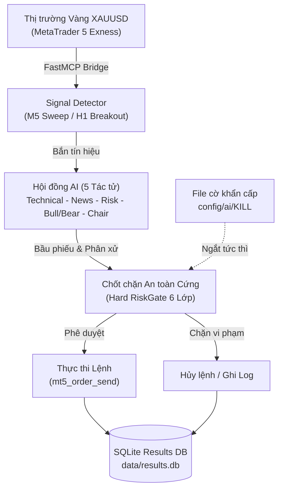

# CẨM NANG HƯỚNG DẪN SỬ DỤNG TM-EA & AI TRADE TỪ A - Z

**Dự án:** TM-EA (Quantitative Scalping & Multi-Agent AI Trade Orchestrator)  
**Phiên bản tài liệu:** v5.2 | **Cập nhật:** 2026-11-20  
**Đối tượng:** Người mới bắt đầu, Trader định lượng và Nhà phát triển hệ thống  
**Tài liệu điều hành tối cao:** [docs/MASTER.md](file:///d:/Applications/TM-EA/docs/MASTER.md)  
**Đặc tả hệ thống:** [SPEC_GOLD_SCALPER.md](file:///d:/Applications/TM-EA/docs/specs/SPEC_GOLD_SCALPER.md) | [SPEC_AI_TRADE_MODULE.md](file:///d:/Applications/TM-EA/docs/specs/SPEC_AI_TRADE_MODULE.md)  

---

## MỤC LỤC
1. [Giới thiệu Hệ sinh thái TM-EA v5.0](#1-giới-thiệu-hệ-sinh-thái-tm-ea-v50)
2. [Cấu trúc Thư mục & Vị trí các File Quan trọng](#2-cấu-trúc-thư-mục--vị-trí-các-file-quan-trọng)
3. [Hướng dẫn Chạy Backtest Robot MQL5 trên MT5](#3-hướng-dẫn-chạy-backtest-robot-mql5-trên-mt5)
   - 3.1. Robot `TM_GoldSweepScalper` (M5 London KZ Judas Sweep)
   - 3.2. Robot `TM_SessionBreakout` (H1 Asian Range Breakout)
4. [Hướng dẫn Cấu hình & Sử dụng MetaTrader 5 FastMCP Server](#4-hướng-dẫn-cấu-hình--sử-dụng-metatrader-5-fastmcp-server)
   - 4.1. Cơ chế kết nối tự động MCP với MT5 Terminal
   - 4.2. Danh mục 11 công cụ (Tools) chuẩn của MT5 MCP
5. [Hướng dẫn Vận hành Hệ thống AI Trade Orchestrator](#5-hướng-dẫn-vận-hành-hệ-thống-ai-trade-orchestrator)
   - 5.1. Chế độ Paper Trading (Phân tích ảo & Ghi log không vào lệnh)
   - 5.2. Chế độ Live Demo Forward (Khớp lệnh tự động vào Exness MT5)
   - 5.3. Quy trình Hội đồng AI 5 Tác tử & Cơ chế Bầu phiếu
6. [Cơ chế Ngắt Khẩn cấp — Physical Kill-Switch](#6-cơ-chế-ngắt-khẩn-cấp--physical-kill-switch)
   - 6.1. Kích hoạt khẩn cấp qua dòng lệnh CLI
   - 6.2. Kích hoạt thủ công qua File cờ `config/ai/KILL`
   - 6.3. Quy trình tự động đóng sạch lệnh bảo vệ vốn
7. [Tra cứu Dữ liệu & Đánh giá Hiệu suất (SQLite results.db)](#7-tra-cứu-dữ-liệu--đánh-giá-hiệu-suất-sqlite-resultsdb)
8. [Xử lý Sự cố Thường gặp (Troubleshooting)](#8-xử-lý-sự-cố-thường-gặp-troubleshooting)
9. [Checklist Hàng ngày cho Trader (Daily Routine)](#9-checklist-hàng-ngày-cho-trader-daily-routine)
10. [Vòng lặp Tự tiến hóa & Tối ưu hóa Tham số (Phase 3 Self-Evolution Engine)](#10-vòng-lặp-tự-tiến-hóa--tối-ưu-hóa-tham-số-phase-3-self-evolution-engine)
11. [Bảng điều khiển Hiệu suất, Giám sát Watchdog & Quản trị Danh mục (Phase 4)](#11-bảng-điều-khiển-hiệu-suất-giám-sát-watchdog--quản-trị-danh-mục-phase-4)

---

## 1. GIỚI THIỆU HỆ SINH THÁI TM-EA v5.0

Hệ thống **TM-EA v5.0** là nền tảng giao dịch định lượng Vàng (`XAUUSD` / `XAUUSDm`) kết hợp giữa **Robot MQL5 tần suất chọn lọc (Rare-fire EA)** và **Hội đồng Trí tuệ Nhân tạo Đa tác tử (Multi-Agent AI Committee)**:



### Các Trụ cột Cốt lõi:
1. **Robot MQL5 Kỹ thuật**:
   - **`TM_SessionBreakout` (P0)**: Phá vỡ biên độ phiên Á (Asian Range Breakout) trên khung H1. Đã kiểm chứng 3 năm (PF 1.527 - 1.666).
   - **`TM_GoldSweepScalper` (P1)**: Bắt nhịp quét thanh khoản giả (Judas Liquidity Sweep) phiên London (07:00 – 10:00 GMT) trên khung M5. Đạt kết quả kiểm định 1 năm tick thật Exness dương lợi nhuận: **PF 1.069, Max Drawdown 7.39%**.
2. **Hội đồng AI Thẩm định (AI Committee)**:
   - 5 tác tử độc lập phân tích đa chiều (Kỹ thuật SMC, Tin tức vĩ mô, Biến động ATR, Tranh luận Phe Bò vs Phe Gấu, Chủ tịch Hội đồng phân xử).
   - Ngăn chặn triệt để các lệnh dính tin bão giá (Non-Farm, CPI) hoặc false breakout.
3. **Chốt chặn An toàn Bất biến (Hard RiskGate)**:
   - AI chỉ là bộ lọc, **không bao giờ có quyền nới lỏng rủi ro hay xóa Stop Loss**.
   - Bắt buộc SL hợp lệ, Max Spread <= 350 pts, rủi ro tối đa <= 1% vốn, khối lượng demo an toàn 0.01 lot.
   - Có Kill-Switch vật lý ngắt khẩn cấp ngay tức thì.

---

## 2. CẤU TRÚC THƯ MỤC & VỊ TRÍ CÁC FILE QUAN TRỌNG

```text
D:\Applications\TM-EA\
├── ai_trade/                    # Module Trí tuệ Nhân tạo (Python 3.11+)
│   ├── bridge/
│   │   └── mt5_mcp_server.py    # MetaTrader 5 FastMCP Server (11 tools chuẩn)
│   ├── committee/               # Hội đồng 5 tác tử (Specialists, Debaters, Chair, Orchestrator)
│   ├── core/
│   │   ├── models.py            # Hợp đồng dữ liệu Pydantic
│   │   ├── provider_router.py   # Bộ định tuyến API đa nhà cung cấp (TokenHarbor, Gemini, OpenAI...)
│   │   ├── risk_gate.py         # Chốt chặn bảo vệ vốn cứng (Hard RiskGate)
│   │   └── safety.py            # Module an toàn & Kill-Switch khẩn cấp
│   ├── signals/
│   │   └── detector.py          # Bộ quét tín hiệu nến real-time M5/H1 từ MT5
│   ├── storage/
│   │   └── db.py                # Quản lý cơ sở dữ liệu SQLite
│   └── runner.py                # File thực thi trung tâm (Paper & Live Trade Runner)
├── config/
│   ├── ai/                      # Toàn bộ cấu hình hệ thống AI
│   │   ├── agents.json          # Thiết lập prompt và phân bổ mô hình cho từng tác tử
│   │   ├── providers.json       # Danh mục các API Provider (TokenHarbor, Gemini, Ollama...)
│   │   └── methods_registry.json# Đăng ký các phương pháp định lượng (ICT/SMC, Wyckoff...)
│   ├── sets/                    # Thư mục chứa các file Preset thông số (.set)
│   │   ├── TM_GoldSweepScalper/ # Presets cho Gold Sweep Scalper M5
│   │   └── TM_SessionBreakout/  # Presets cho Session Breakout H1
│   └── test/                    # Các file cấu hình kiểm thử (.ini)
├── data/
│   └── results.db               # Cơ sở dữ liệu SQLite lưu vết toàn bộ quyết định của AI
├── docs/                        # Toàn bộ tài liệu kỹ thuật, kế hoạch và cẩm nang
│   ├── README.md                # Bản đồ tài liệu tổng quan
│   ├── MASTER.md                # Tài liệu điều hành tối cao
│   ├── USER_GUIDE.md            # Tài liệu này (Hướng dẫn sử dụng từ A-Z)
│   └── CHANGELOG.md             # Nhật ký cập nhật kỹ thuật
├── MQL5/
│   ├── Experts/                 # Mã nguồn EA MQL5 (.mq5 và .ex5)
│   └── Include/TM_EA/           # Các module MQL5 tái sử dụng (.mqh)
└── tests/                       # Bộ kiểm thử tự động (Pytest test suite)
```

---

## 3. HƯỚNG DẪN CHẠY BACKTEST ROBOT MQL5 TRÊN MT5

### Quy trình Chuẩn bị Chung
1. Khởi động phần mềm **MetaTrader 5 Exness**.
2. Nhấn tổ hợp phím **`Ctrl + R`** để mở cửa sổ **Strategy Tester**.
3. Tại giao diện ban đầu, chọn mục **Single** (Kiểm thử đơn kỳ).

---

### 3.1. Kiểm thử Robot `TM_GoldSweepScalper` (Khuyên dùng cho M5)

1. **Thiết lập tại tab Settings:**
   - **Expert**: `TM_GoldSweepScalper.ex5`
   - **Symbol**: `XAUUSDm` (hoặc `XAUUSD` tùy loại tài khoản)
   - **Period**: `M5`
   - **Date**: Chọn khoảng thời gian (Khuyên dùng: `2025.08.01` đến `2026.07.31` để kiểm tra trọn vẹn 1 năm).
   - **Model**: **`Every tick based on real ticks`** (Bắt buộc chọn mô hình này để test chính xác 100% từng tick thật của sàn Exness).
   - **Deposit**: `5000` (hoặc `1000`) USD.
   - **Leverage**: `1:100`.
   - **Optimization**: `Disabled`.
2. **Nạp Preset thông số tại tab Inputs:**
   - Chuyển sang tab **Inputs**.
   - Nhấp chuột phải -> Chọn **Load**.
   - Trỏ tới file: [config/sets/TM_GoldSweepScalper/TM_GSS_XAUUSD_M5_BASELINE_v1_0.set](file:///d:/Applications/TM-EA/config/sets/TM_GoldSweepScalper/TM_GSS_XAUUSD_M5_BASELINE_v1_0.set).
   - Nhấn **Open**.
3. **Bắt đầu chạy:**
   - Nhấn nút **Start** màu xanh.
   - **Kết quả kỳ vọng (Baseline 1 năm tick thật)**:
     - Lợi nhuận ròng: **+177.68 USD**.
     - Profit Factor (PF): **1.069**.
     - Max Equity Drawdown: **7.39%** (Bảo vệ vốn tuyệt đối dưới ngưỡng 8%).
     - Tần suất: ~13 lệnh / tháng (Rare-fire, chọn lọc kỹ).

---

### 3.2. Kiểm thử Robot `TM_SessionBreakout` (H1 Asian Breakout)

1. **Thiết lập tại tab Settings:**
   - **Expert**: `TM_SessionBreakout.ex5`
   - **Symbol**: `XAUUSDm`
   - **Period**: `H1`
   - **Date**: `2023.01.01` đến `2026.01.01` (Kiểm thử 3 năm).
   - **Model**: `Every tick based on real ticks`.
2. **Nạp Preset tại tab Inputs:**
   - Nhấp chuột phải -> **Load** -> Chọn [config/sets/TM_SessionBreakout/TM_SB_XAUUSD_H1_BASELINE_v1_0.set](file:///d:/Applications/TM-EA/config/sets/TM_SessionBreakout/TM_SB_XAUUSD_H1_BASELINE_v1_0.set).
3. **Kết quả kỳ vọng:**
   - Profit Factor: **1.527 – 1.666**.
   - Max Equity Drawdown: **< 8.0%**.
   - Tần suất: ~1 lệnh / ngày giao dịch.

---

## 4. HƯỚNG DẪN CẤU HÌNH & SỬ DỤNG METATRADER 5 FASTMCP SERVER

Hệ thống tích hợp sẵn một máy chủ **FastMCP Server** tại [ai_trade/bridge/mt5_mcp_server.py](file:///d:/Applications/TM-EA/ai_trade/bridge/mt5_mcp_server.py), cho phép AI Agent và IDE giao tiếp trực tiếp với phần mềm MetaTrader 5 đang chạy trên máy.

### 4.1. Cơ chế Hoạt động
- Máy chủ MCP kết nối ngầm với tệp thực thi MT5 tại:  
  `C:\Program Files\MetaTrader 5 EXNESS\terminal64.exe`
- Đã được đăng ký sẵn trong file cấu hình Antigravity toàn cục:  
  `C:\Users\tuanmjnh\.gemini\config\mcp_config.json` và `settings.json`.
- Khối lượng giao dịch tối đa qua MCP được giới hạn cứng ở mức: **`0.5 lot`** (để chống lỗi fat-finger).

### 4.2. Danh mục 11 Công cụ (Tools) Sẵn sàng Gọi

| Tên Tool MCP | Mô tả & Chức năng | Tham số chính |
|---|---|---|
| `mt5_status` | Kiểm tra trạng thái kết nối terminal, số tài khoản, server, số dư và quyền đặt lệnh | Không |
| `mt5_account_info` | Lấy chi tiết số dư (Balance), vốn thực (Equity), Margin, Margin Level, Đòn bẩy | Không |
| `mt5_symbol_info` | Đọc giá Bid/Ask thời gian thực, Spread thực tế, Digits, Point của mã Vàng | `symbol` (ví dụ `"XAUUSDm"`) |
| `mt5_rates` | Lấy dữ liệu nến lịch sử OHLCV đa khung thời gian | `symbol`, `timeframe` (`"M1"` -> `"D1"`), `count` |
| `mt5_ticks` | Lấy luồng tick giá micro-structure và biến động spread sát sao | `symbol`, `count` (1 đến 200) |
| `mt5_positions` | Liệt kê toàn bộ các lệnh đang mở kèm lợi nhuận PnL, giá vào, SL, TP | `symbol` (tùy chọn) |
| `mt5_orders` | Liệt kê các lệnh chờ (Buy Limit, Sell Stop...) đang active | `symbol` (tùy chọn) |
| `mt5_history_deals` | Truy vấn lịch sử các giao dịch đã đóng để tính toán hiệu suất | `days` (mặc định 7 ngày), `symbol` |
| `mt5_order_send` | Đặt lệnh thị trường hoặc lệnh chờ có chốt chặn an toàn (bắt buộc SL) | `symbol`, `action` (`"BUY"`, `"SELL"`), `volume`, `sl`, `tp` |
| `mt5_position_close` | Đóng một vị thế theo mã vé (Ticket) với độ trượt giá quy định | `ticket`, `deviation` |
| `mt5_position_modify` | Điều chỉnh dời Stop Loss (SL) hoặc Take Profit (TP) cho vị thế đang chạy | `ticket`, `sl`, `tp` |

---

## 5. HƯỚNG DẪN VẬN HÀNH HỆ THỐNG AI TRADE ORCHESTRATOR

Module trung tâm `ai_trade.runner` điều phối toàn bộ chu trình thông minh từ quét nến, phân tích hội đồng đến vào lệnh.

Mở terminal PowerShell tại thư mục dự án `D:\Applications\TM-EA\`:

### 5.1. Chế độ Paper Trading (Khuyên dùng khi mới làm quen)
Chế độ này phân tích thị trường thật, triệu tập đầy đủ Hội đồng AI tranh luận nhưng **CHỈ GHI LOG VÀO DATABASE, TUYỆT ĐỐI KHÔNG ĐẶT LỆNH THẬT**.

- **Chạy kiểm nghiệm 1 chu kỳ duy nhất (Single pass) rồi thoát:**
  ```powershell
  python -m ai_trade.runner --once --mode paper
  ```
- **Chạy vòng lặp tự động liên tục (Mặc định quét mỗi 30 giây):**
  ```powershell
  python -m ai_trade.runner --interval 30 --mode paper
  ```
- **Tùy chỉnh mã giao dịch:**
  ```powershell
  python -m ai_trade.runner --symbol XAUUSDm --interval 15 --mode paper
  ```

---

### 5.2. Chế độ Live Demo Forward (Khớp lệnh tự động vào MT5)
Chế độ này sẽ thực sự gửi lệnh vào tài khoản MetaTrader 5 (khuyên dùng trên **Tài khoản Demo Exness**).

- **Lệnh chạy tự động (Khối lượng an toàn cố định 0.01 lot):**
  ```powershell
  python -m ai_trade.runner --interval 30 --mode live --lot 0.01
  ```
- **Cơ chế an toàn tự động áp dụng:**
  - Nếu Hội đồng ra phán quyết `HOLD` hoặc `CANCEL`: **Không vào lệnh**.
  - Nếu Hội đồng ra phán quyết `BUY` hoặc `SELL`: Lệnh chỉ được gửi đi nếu vượt qua 6 lớp kiểm duyệt của **Hard RiskGate**.
  - Nếu vi phạm (ví dụ SL ngược chiều, Spread dãn quá 350 pts): **Lệnh bị hủy ngay lập tức**.

---

### 5.3. Quy trình Hội đồng AI 5 Tác tử Phân tích & Bầu phiếu

Mỗi khi xuất hiện tín hiệu nến (Setup), quy trình sau sẽ diễn ra tự động trong **< 3 giây**:

```text
[Signal Detected: M5 London Judas Sweep]
   │
   ├── 1. Technical Analyst: Đánh giá độ xuyên quét thanh khoản & nến xác nhận SMC.
   ├── 2. News/Sentiment Analyst: Tra cứu lịch kinh tế, đảm bảo không có tin đỏ Mỹ.
   ├── 3. Risk Analyst: Đánh giá spread hiện tại và biến động ATR.
   │
   ├── 4. Vòng Tranh luận (Debate):
   │      - Bull Advocate: Nêu luận điểm mua và phản bác rủi ro.
   │      - Bear Advocate: Nêu luận điểm bán và cảnh báo bẫy giá.
   │
   ├── 5. Chủ tịch Hội đồng (Committee Chair):
   │      - Đưa ra Phán quyết tối cao (5-Tier Verdict):
   │        * STRONG_BUY / BUY (100% volume đề xuất)
   │        * OVERWEIGHT (50% - 70% volume)
   │        * HOLD (Hủy lệnh, đứng ngoài thị trường)
   │        * UNDERWEIGHT (Giảm volume)
   │        * SELL / STRONG_SELL (100% sell volume)
   │
   └── 6. Hard RiskGate: Kiểm tra tính toán học trước khi đẩy ra MT5 Terminal.
```

---

### 5.4. Vòng lặp Tự tiến hóa & Tối ưu hóa Tham số (Self-Evolution Engine)

Hệ thống cho phép AI tự động đột biến tham số chiến lược trong vùng `AI_MUTATION_ZONE`, tự chạy backtest, tự kiểm định Walk-Forward OOS và tự động Rollback nếu hiệu suất suy giảm:

- **Chạy kiểm nghiệm nhanh 3 chu kỳ tiến hóa (Chế độ mô phỏng nhanh):**
  ```powershell
  python -m ai_trade.evolution.optimizer --cycles 3 --mock
  ```
- **Chạy tiến hóa kết hợp Strategy Tester MT5 trên tick thật:**
  ```powershell
  python -m ai_trade.evolution.optimizer --cycles 1 --strategy TM_GoldSweepScalper
  ```
- **Quay về bản tham số Champion trước đó (Auto-Rollback):**
  ```powershell
  python -m ai_trade.evolution.optimizer --rollback
  ```
- **Cơ chế an toàn cốt lõi:**
  - AI chỉ được phép đột biến trong `AI_MUTATION_ZONE` (ví dụ `Sweep_RR`, `Min_Range_ATR`, `Breakeven_ATR_Mult`).
  - Các khối bảo vệ vốn (`RiskPercentPerTrade`, `Max_Spread_Points`, `Circuit_Breaker_DD_Pct`) **được đóng băng vĩnh viễn (Frozen)**.
  - Nếu Profit Factor của biến thể mới bị suy giảm > 10% so với baseline cũ: **Hệ thống tự động hủy và Rollback về Champion cũ**.
  - Toàn bộ lịch sử tiến hóa được ghi nhận minh bạch tại file [config/ai/lineage_tree.json](file:///d:/Applications/TM-EA/config/ai/lineage_tree.json).

---

## 6. CƠ CHẾ NGẮT KHẨN CẤP — PHYSICAL KILL-SWITCH

Khi thị trường xảy ra thiên nga đen (Black Swan), tin tức chiến tranh bất ngờ, hoặc bạn muốn dừng toàn bộ hoạt động giao dịch ngay lập tức:

### 6.1. Kích hoạt Khẩn cấp qua Dòng lệnh (CLI)
Chạy lệnh sau tại PowerShell:
```powershell
python -m ai_trade.runner --kill
```
**Hệ thống sẽ thực hiện ngay 3 hành động song song:**
1. Tạo lập tức file cờ `config/ai/KILL`.
2. Đóng sạch toàn bộ các vị thế Vàng đang mở trên MT5.
3. Hủy bỏ toàn bộ các lệnh chờ (Pending orders) đang active.

### 6.2. Kích hoạt Thủ công qua File Cờ
Chỉ cần tạo một file trống có tên `KILL` bên trong thư mục [config/ai/](file:///d:/Applications/TM-EA/config/ai/):
- Đường dẫn: `d:\Applications\TM-EA\config\ai\KILL`
- Ngay tại tick quét tiếp theo, Runner sẽ thông báo:
  ```text
  [CRITICAL] 🛑 [KILL-SWITCH ACTIVE] Trading cycle aborted. config/ai/KILL detected.
  ```
  Và tự động từ chối mọi hoạt động giao dịch.

### 6.3. Mở lại Hệ thống Giao dịch Bình thường
Sau khi tình hình thị trường ổn định, để cho phép hệ thống hoạt động trở lại:
- Xóa file `config/ai/KILL` (hoặc file `config/KILL` nếu có).
- Hoặc chạy lệnh Python:
  ```powershell
  python -c "from ai_trade.core.safety import clear_kill; clear_kill()"
  ```

---

## 7. TRA CỨU DỮ LIỆU & ĐÁNH GIÁ HIỆU SUẤT (SQLite RESULTS.DB)

Toàn bộ quá trình ra quyết định của AI và kết quả giao dịch được lưu trữ vĩnh viễn tại tệp cơ sở dữ liệu SQLite:  
`d:\Applications\TM-EA\data\results.db`

### Cách Tra cứu Nhanh qua PowerShell:

1. **Xem 5 quyết định gần nhất của Hội đồng AI:**
   ```powershell
   python -c "
   import sqlite3
   conn = sqlite3.connect('data/results.db')
   c = conn.cursor()
   c.execute('SELECT id, timestamp, symbol, source_setup, verdict, confidence, validation_passed FROM trade_decisions ORDER BY id DESC LIMIT 5')
   for r in c.fetchall():
       print(f'ID #{r[0]} | {r[1]} | {r[2]} | Setup: {r[3]} | Phán quyết: {r[4]} | Tin cậy: {r[5]*100:.0f}% | RiskGate: {bool(r[6])}')
   conn.close()
   "
   ```

2. **Xem chi tiết lập luận của Chủ tịch Hội đồng tại một lệnh cụ thể (Ví dụ ID #10):**
   ```powershell
   python -c "
   import sqlite3
   conn = sqlite3.connect('data/results.db')
   c = conn.cursor()
   c.execute('SELECT id, verdict, chair_reasoning FROM trade_decisions WHERE id=10')
   row = c.fetchone()
   print(f'ID #{row[0]} Phán quyết: {row[1]}\nLý do: {row[2]}')
   conn.close()
   "
   ```

---

## 8. XỬ LÝ SỰ CỐ THƯỜNG GẶP (TROUBLESHOOTING)

| Hiện tượng | Nguyên nhân | Cách khắc phục triệt để |
|---|---|---|
| `MT5 Terminal not connected: False` | Phần mềm MetaTrader 5 chưa được bật trên máy tính. | Mở MetaTrader 5 Exness lên và đăng nhập vào tài khoản trước khi chạy script Python. |
| `OrderSend error 10027 (AutoTrading disabled)` | Chưa bật nút cho phép robot đặt lệnh trên MT5. | Trên thanh công cụ MT5, nhấn bật nút **`Algo Trading`** (biểu tượng chuyển sang màu xanh lá). |
| `Symbol 'XAUUSDm' not found` | Loại tài khoản của bạn dùng ký hiệu khác (ví dụ tài khoản Standard là `XAUUSD`, tài khoản Cent là `XAUUSDc`). | Truyền cờ `--symbol XAUUSD` tương ứng khi chạy lệnh: `python -m ai_trade.runner --symbol XAUUSD`. |
| `BLOCKED BY HARD RISKGATE: SPREAD_EXCEEDED` | Thị trường ban đêm hoặc lúc ra tin có spread dãn vượt ngưỡng 350 pts. | Đây là tính năng bảo vệ vốn tự động. Hệ thống sẽ tự giao dịch trở lại khi spread co hẹp bình thường. |
| `BLOCKED BY HARD RISKGATE: KILL_SWITCH_ACTIVE` | Đang tồn tại file cờ ngắt khẩn cấp `config/ai/KILL`. | Xóa file `config/ai/KILL` để mở lại hệ thống. |
| `ModuleNotFoundError: No module named 'fastmcp'` | Chưa cài đặt thư viện vào Python 3.11. | Chạy lệnh: `pip install fastmcp MetaTrader5 pydantic pytest`. |
| Lệnh kiểm thử báo lỗi import DLL `pywintypes` | Xung đột thư viện `pywin32` trên Windows. | Đã được khắc phục trong file `mt5_mcp_server.py` bằng việc ưu tiên import `fastmcp` thuần. |

---

## 9. CHECKLIST HÀNG NGÀY CHO TRADER (DAILY ROUTINE)

- [ ] **Đầu ngày (06:45 GMT / 13:45 VN)**: Bật MT5 Terminal, kiểm tra kết nối tài khoản.
- [ ] **Kiểm tra trạng thái**: Chạy lệnh kiểm tra nhanh `python -m ai_trade.runner --once --mode paper`.
- [ ] **Bật Runner**: Bật chế độ chạy nền `python -m ai_trade.runner --interval 30 --mode live --lot 0.01` trong suốt phiên London (07:00 – 10:00 GMT).
- [ ] **Cuối ngày**: Tra cứu `data/results.db` để kiểm tra các quyết định của AI và đối soát PnL với lịch sử lệnh trên MT5.
- [ ] **Khi có sự cố**: Dùng lệnh `python -m ai_trade.runner --kill` để ngắt khẩn cấp.

---

## 10. VÒNG LẶP TỰ TIẾN HÓA & TỐI ƯU HÓA THAM SỐ (PHASE 3 SELF-EVOLUTION ENGINE)

Hệ sinh thái TM-EA trang bị module tự tiến hóa `ai_trade/evolution/` giúp hệ thống liên tục tinh chỉnh các tham số thích nghi với chế độ thị trường mới mà không can thiệp vào các quy tắc an toàn cốt lõi.

### 10.1. Vùng đột biến an toàn (AI Mutation Zone)
Trong mã nguồn MQL5 (`MQL5/Experts/TM_GoldSweepScalper.mq5` & `TM_SessionBreakout.mq5`), chỉ các tham số nằm giữa hai thẻ sau mới được phép thay đổi:
```mql5
// >>> AI_MUTATION_ZONE_START: Parameters permitted for automated optimization
input int      InpAsianStartHour  = 0;
input int      InpAsianEndHour    = 6;
// ...
// <<< AI_MUTATION_ZONE_END
```
Toàn bộ logic tính Stop Loss, Max Lot, Cooldown và ngắt khẩn cấp nằm trong vùng `[FROZEN SAFETY CODE]` bị đóng băng vĩnh viễn, AI không thể sửa đổi.

### 10.2. Chạy chu kỳ tự tiến hóa bằng CLI
```powershell
# Chạy 3 chu kỳ tối ưu hóa mô phỏng (an toàn, không bật MT5 GUI)
python -m ai_trade.evolution.optimizer --cycles 3 --mock

# Chạy tối ưu hóa thực tế với MT5 Strategy Tester (Headless)
python -m ai_trade.evolution.optimizer --strategy TM_GoldSweepScalper --cycles 1

# Khôi phục (Rollback) về bộ tham số Champion ổn định gần nhất
python -m ai_trade.evolution.optimizer --rollback
```

### 10.3. Tiêu chí sàng lọc Walk-Forward & Monte Carlo
Một bộ tham số mới chỉ được thăng hạng làm Champion khi:
1. **Walk-Forward Analysis (4 cửa sổ x 2)**: Tỷ số hiệu suất Out-of-Sample (OOS) so với In-sample (IS) đạt `WFA Efficiency >= 0.50`.
2. **Monte Carlo 100 Runs**: Mức sụt giảm vốn ở phân vị 95% (`95th Drawdown`) <= 15.0% và rủi ro cháy tài khoản (`Risk of Ruin`) <= 1.0%.
3. **Cơ chế chống suy giảm (Degradation Shield)**: Nếu Profit Factor giảm > 10% so với Champion cũ, hệ thống tự động từ chối và Rollback.

---

## 11. BẢNG ĐIỀU KHIỂN HIỆU SUẤT, GIÁM SÁT WATCHDOG & QUẢN TRỊ DANH MỤC (PHASE 4)

### 11.1. Bảng điều khiển Đánh giá Go-Live (Performance Dashboard)
Trước khi nâng quy mô từ Demo Cent sang tài khoản vốn thật, hãy chạy lệnh thẩm định:
```powershell
python -m ai_trade.reporting.dashboard
```
Hệ thống sẽ đối soát toàn bộ lịch sử trong `data/results.db` và chấm điểm 5 Cổng Go-Live:
- **Gate 1**: Tối thiểu ≥ 50 giao dịch thực tế trên Demo Cent.
- **Gate 2**: Profit Factor (PF) ≥ 1.30.
- **Gate 3**: Maximum Equity Drawdown ≤ 12.0%.
- **Gate 4**: Zero Fatal Safety Violations (0 lần vi phạm SL/RiskGate).
- **Gate 5**: AI Filter Efficiency (Hội đồng lọc bỏ thành công > 10% tín hiệu nhiễu).

### 11.2. Quản trị Danh mục & Phân bổ Vốn (Portfolio Manager)
Module `ai_trade/core/portfolio.py` tự động kiểm soát danh mục:
- **Tỷ trọng mục tiêu**: 60% cho `TM_GoldSweepScalper` (Scalp phiên London) và 40% cho `TM_SessionBreakout` (Breakout phiên Á).
- **Trần rủi ro đồng thời (Aggregate Risk Cap)**: Tổng rủi ro của tất cả các vị thế đang mở trên tài khoản không vượt quá **2.0% Equity**.
- **Hệ số thăm dò Live (Live Probing Multiplier)**: Khi kích hoạt tài khoản thật (`--mode live`), hệ thống tự động nhân hệ số `0.25x` (rủi ro giảm còn 0.25%/lệnh) trong giai đoạn thăm dò ban đầu.

### 11.3. Giám sát Hệ thống (System Watchdog & Heartbeat)
Khi Trade Runner hoạt động, `SystemWatchdog` sẽ liên tục phát xung nhịp vào file `config/ai/heartbeat.json`:
- Cung cấp thông tin trạng thái (`RUNNING`, `CONNECTED`, `HALTED`), mã PID tiến trình, thời gian hoạt động liên tục (uptime) và thông số thị trường.
- Trader hoặc các dịch vụ giám sát bên ngoài (Zabbix, Prometheus, Telegram Bot) có thể đọc file JSON này để kích hoạt cảnh báo nếu heartbeat bị ngắt quá 60 giây.
