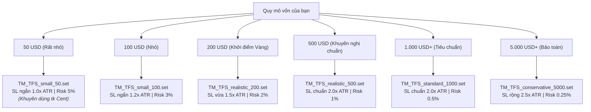

# HƯỚNG DẪN SỬ DỤNG TM-EA TỪ A - Z CHO NGƯỜI MỚI

**Dự án:** TM-EA  
**EA:** `TM_TrendFollowerScalper`  
**Chiến lược:** `TM_TFS_V1` (Trend Follower Scalper)  
**Cặp giao dịch:** Vàng - XAUUSD (hoặc XAUUSDm trên Exness)  
**Khung thời gian:** M5 (Vào lệnh) & M15 (Bộ lọc xu hướng)  
**Cập nhật lần cuối:** 2026-11-12  

Tài liệu này dành cho người mới bắt đầu, hướng dẫn chi tiết từng bước từ cài đặt, cấu hình, chạy backtest, xuất báo cáo cho đến cách vận hành EA an toàn trên tài khoản demo.

---

## MỤC LỤC
1. [Hiểu nhanh về chiến lược TM-EA](#1-hiểu-nhanh-về-chiến-lược-tm-ea)
2. [Vị trí các thư mục quan trọng trên máy](#2-vị-trí-các-thư-mục-quan-trọng-trên-máy)
3. [Hướng dẫn từng bước chạy Backtest trên MT5](#3-hướng-dẫn-từng-bước-chạy-backtest-trên-mt5)
4. [Hướng dẫn chọn Preset (.set) theo quy mô vốn](#4-hướng-dẫn-chọn-preset-set-theo-quy-mô-vốn)
5. [Dữ liệu Backtest nằm ở đâu và cách xuất báo cáo](#5-dữ-liệu-backtest-nằm-ở-đâu-và-cách-xuất-báo-cáo)
6. [Cách đọc và đánh giá các chỉ số báo cáo](#6-cách-đọc-và-đánh-giá-các-chỉ-số-báo-cáo)
7. [Hướng dẫn cài đặt chạy Forward Test Demo trên biểu đồ](#7-hướng-dẫn-cài-đặt-chạy-forward-test-demo-trên-biểu-đồ)
8. [Các sự cố thường gặp & Cách khắc phục](#8-các-sự-cố-thường-gặp--cách-khắc-phục)

---

## 1. HIỂU NHANH VỀ CHIẾN LƯỢC TM-EA

`TM_TrendFollowerScalper` là robot giao dịch thuật toán theo trường phái **Micro-Scalping bám theo xu hướng**:
- **Nguyên lý cốt lõi:**
  1. **Lọc xu hướng lớn (M15)**: Chỉ mua khi có Uptrend rõ ràng (Fast EMA > Slow EMA và ADX > 25), chỉ bán khi có Downtrend. Nếu thị trường đi ngang (Sideway) thì EA **đứng ngoài 100%**.
  2. **Tìm điểm vào lệnh nhỏ (M5)**: Vào lệnh theo 2 cơ chế:
     - **Pullback**: Giá hồi về đường EMA 20 rồi nến đóng xác nhận quay lại xu hướng.
     - **Breakout**: Giá phá vỡ biên kênh ATR của nến trước kèm nến đóng xác nhận và EMA dốc theo chiều trend.
  3. **Không đặt Take Profit (No TP)**: Thay vì chốt lời cố định, EA dùng **Trailing Stop động theo ATR**. Khi thị trường tạo sóng lớn, SL sẽ tự động dời bám sát giá để tối đa hóa lợi nhuận. Khi giá đảo chiều, SL sẽ đóng lệnh bảo toàn lãi.
  4. **Kỷ luật vốn tuyệt đối**: Bắt buộc có SL ban đầu cho mọi lệnh, tự động tính volume theo % rủi ro cố định, không bao giờ gồng lỗ, **tuyệt đối không Martingale / không gấp thếp**.

---

## 2. VỊ TRÍ CÁC THƯ MỤC QUAN TRỌNG TRÊN MÁY

Để thuận tiện quản lý, dự án chia làm 2 khu vực lưu trữ:

### 2.1. Thư mục Mã nguồn Dự án (Workspace)
Đường dẫn: `D:\Applications\TM-EA\`
- `docs/`: Chứa tài liệu hướng dẫn (`MASTER.md`, `USER_GUIDE.md`, `ARCHITECTURE.md`...).
- `MQL5/Experts/`: Chứa file mã nguồn chính `TM_TrendFollowerScalper.mq5` và file đã biên dịch `TM_TrendFollowerScalper.ex5`.
- `config/sets/`: Chứa toàn bộ các file preset cấu hình mẫu (`.set`) tương ứng với từng mức vốn.
- `reports/backtests/`: Nơi lưu trữ các báo cáo kết quả backtest, được phân cấp theo từng bot và từng cấu hình preset (`TM_TrendFollowerScalper/<PresetName>/`).
- `reports/forward/`: Nơi lưu nhật ký và kết quả chạy thử nghiệm demo trực tiếp.

### 2.2. Thư mục Dữ liệu MT5 Terminal (AppData)
Đường dẫn: `C:\Users\tuanmjnh\AppData\Roaming\MetaQuotes\Terminal\53785E099C927DB68A545C249CDBCE06\`
*(Bạn có thể mở nhanh bằng cách trong MT5 chọn menu: **File -> Open Data Folder**)*
- `MQL5\Experts\`: Nơi MT5 nhìn thấy robot để cho phép kéo vào biểu đồ hoặc chạy tester.
- `MQL5\Profiles\Tester\`: Nơi lưu các file preset `.set` và cấu hình `.ini` để nạp nhanh vào Strategy Tester.
- `Tester\logs\`: Chứa file nhật ký tổng của trình kiểm thử MT5.

### 2.3. Thư mục Nhật ký Tester Agent (Chi tiết từng lệnh)
Đường dẫn: `C:\Users\tuanmjnh\AppData\Roaming\MetaQuotes\Tester\53785E099C927DB68A545C249CDBCE06\Agent-127.0.0.1-3000\logs\`
- Chứa toàn bộ log in ra từ robot trong lúc chạy backtest (lý do vào lệnh, lý do skip, thông báo dời trailing SL...).

---

## 3. HƯỚNG DẪN TỪNG BƯỚC CHẠY BACKTEST TRÊN MT5

### Bước 1: Mở trình kiểm thử chiến lược (Strategy Tester)
1. Mở phần mềm MetaTrader 5.
2. Nhấn tổ hợp phím **`Ctrl + R`** (hoặc chọn menu **View -> Strategy Tester**).
3. Nếu hiện giao diện chọn mục, nhấn chọn biểu tượng **Single** (Kiểm thử đơn).

### Bước 2: Thiết lập thông số kiểm thử (Tab Settings)
Tại thanh cài đặt bên dưới tab **Settings**, bạn chọn các mục như sau:

| Trường thiết lập | Giá trị chọn | Giải thích |
|---|---|---|
| **Expert** | `TM_TrendFollowerScalper.ex5` | Chọn đúng tên robot TM-EA |
| **Symbol** | `XAUUSDm` (hoặc `XAUUSD`) | Cặp giao dịch vàng (trên tài khoản Exness là `XAUUSDm`) |
| **Period** | `M5` | Khung thời gian scalp vào lệnh |
| **Date** | `Custom period` (hoặc `Last 3 months`) | Chọn khoảng thời gian test (ví dụ: `2026.08.01` đến `2026.10.31`) |
| **Forward** | `No` | Không dùng chế độ forward tự động |
| **Delays** | `Zero latency` hoặc `Random delay` | Độ trễ mạng (chọn Random delay nếu muốn kiểm tra trượt giá) |
| **Model** | **`Every tick based on real ticks`** | **Bắt buộc chọn mô hình này** để test chính xác từng tick thật của sàn Exness |
| **Deposit** | Nhập số vốn mong muốn (ví dụ `200`, `500` hoặc `1000`) | Đơn vị tiền tệ chọn `USD` |
| **Leverage** | `1:100` | Đòn bẩy tài khoản |
| **Optimization** | `Disabled` | Tắt tối ưu hóa tham số (chỉ chạy kiểm thử 1 lần) |
| **Visual mode** | Tùy chọn (Bật để xem biểu đồ chạy, tắt để chạy siêu tốc) | |

### Bước 3: Nạp Preset tham số (Tab Inputs)
1. Chuyển sang tab **Inputs** trên thanh công cụ Strategy Tester.
2. Nhấp **chuột phải** vào bất kỳ vị trí nào trong bảng tham số -> chọn **Load**.
3. Chọn file preset phù hợp với số vốn bạn muốn kiểm tra (ví dụ: `TM_TFS_realistic_200.set` hoặc `TM_TFS_realistic_500.set`).
4. Nhấn **Open**. Toàn bộ các thông số sẽ tự động được điền chuẩn xác.

### Bước 4: Bắt đầu chạy
- Nhấn nút **Start** màu xanh ở góc phải bên dưới.
- Quá trình chạy sẽ bắt đầu: MT5 sẽ tự động đồng bộ dữ liệu tick lịch sử từ máy chủ sàn và chạy thuật toán.

---

## 4. HƯỚNG DẪN CHỌN PRESET (.SET) THEO QUY MÔ VỐN

Hệ thống cung cấp sẵn các file preset trong thư mục `config/sets/` (đã đồng bộ vào MT5):

### Chi tiết ý nghĩa các tham số trong Preset:
- **`RiskPercentPerTrade`**: % số dư tài khoản chấp nhận mất nếu dính SL ban đầu.
- **`Trail_ATR_Mult`**: Khoảng cách thả trôi Stop Loss theo độ biến động ATR.
  - Số nhỏ (1.0x - 1.5x): Cắt lỗ ngắn, bảo vệ vốn chặt, phù hợp tài khoản nhỏ.
  - Số lớn (2.0x - 2.5x): Cho giá không gian rung lắc để ôm trọn các con sóng trend dài.
- **`Max_Spread_Points = 350`**: Giới hạn spread tối đa cho phép vào lệnh là 35 cents (3.5 pips). Khi thị trường mở cửa ban đêm hoặc có tin bão làm spread dãn vượt 350 points, EA sẽ tự động đứng ngoài không mở lệnh.
- **`News_Enable = true`**: Tránh giao dịch trước và sau 20 phút khi có tin tức đỏ (High Impact).
- **`Entry_Mode = 3`**: Bật cả 2 cơ chế (1=Pullback, 2=Breakout, 3=Both).

> 💡 **LƯU Ý QUAN TRỌNG VỀ TÍNH TƯƠNG THÍCH**:  
> Toàn bộ các file `.set` trên **được thiết kế để dùng chung 100% cho cả Strategy Tester (Backtest) và Biểu đồ Demo trực tiếp (Live Forward Test)**. Khi mở tài khoản demo với bất kỳ số vốn nào (từ 50$ đến 5000$), bạn chỉ cần kéo EA vào biểu đồ demo và **Load đúng file preset tương ứng** là EA sẽ vận hành tự động theo đúng ngân sách rủi ro đã được tính toán.

---

## 5. DỮ LIỆU BACKTEST NẰM Ở ĐÂU VÀ CÁCH XUẤT BÁO CÁO

Sau khi thanh trạng thái chạy xong 100%, kết quả sẽ hiển thị trên thanh tab của Strategy Tester:

### 5.1. Xem kết quả trực tiếp trên MT5
- Tab **Backtest (Báo cáo)**: Xem tổng quan lợi nhuận, drawdown, số lệnh thắng/thua, profit factor...
- Tab **Graph (Biểu đồ)**: Xem đường cong tăng trưởng vốn (Equity & Balance curve).
- Tab **Deals (Giao dịch)**: Danh sách chi tiết từng lệnh mua/bán, giá vào, giá dời SL và giá đóng lệnh.
- Tab **Journal (Nhật ký)**: Xem thông báo hệ thống và log chẩn đoán của bot.

### 5.2. Cách xuất (Export) báo cáo ra file lưu trữ
1. Nhấp chuột vào tab **Backtest** (Báo cáo).
2. Nhấp **chuột phải** vào bất kỳ vị trí nào trên bảng kết quả.
3. Chọn **Report** -> chọn định dạng **HTML (Chrome, Edge...)**.
4. Cửa sổ lưu file hiện ra:
   - Hãy điều hướng lưu vào đúng thư mục của Bot và Preset tương ứng:  
     `D:\Applications\TM-EA\reports\backtests\TM_TrendFollowerScalper\<Tên_Preset>\`  
     *(Ví dụ: Với preset 200 USD, lưu vào `reports\backtests\TM_TrendFollowerScalper\TM_TFS_realistic_200\`)*
   - Đặt tên file theo cú pháp chuẩn: `<Tên_Preset>_<YYYY.MM.DD_HH.MM>.html`  
     *(Ví dụ: `TM_TFS_realistic_200_2026.11.12_12.30.html`)*.
   - Nhấn **Save**.
5. MT5 sẽ tạo ra 1 file `.html` (hoặc `.htm`) và các ảnh đồ thị tương ứng. Bạn có thể mở file này bằng bất kỳ trình duyệt web nào để xem lại bất cứ lúc nào.

---

## 6. CÁCH ĐỌC VÀ ĐÁNH GIÁ CÁC CHỈ SỐ BÁO CÁO

Khi xem báo cáo HTML, hãy tập trung vào các chỉ số sau (đừng chỉ nhìn mỗi Net Profit):

| Chỉ số | Tên tiếng Anh | Tiêu chuẩn đánh giá an toàn |
|---|---|---|
| **Lợi nhuận ròng** | `Total Net Profit` | Lợi nhuận sau khi trừ toàn bộ các lệnh lỗ. |
| **Hệ số lợi nhuận** | `Profit Factor (PF)` | **Phải > 1.5** (Khuyến nghị 1.8 - 2.5). Nếu PF < 1.2, chiến lược rất mong manh trước phí giao dịch. |
| **Tỷ lệ sụt giảm tối đa** | `Maximal Drawdown (Equity)` | **Nên < 15% - 20%**. Đây là mức sụt giảm tài khoản sâu nhất trong suốt giai đoạn test. |
| **Kỳ vọng mỗi lệnh** | `Expected Payoff` | **Phải > 1.0 USD**. Đại diện cho số tiền kỳ vọng kiếm được trên mỗi lệnh mở ra. |
| **Tỷ lệ lệnh thắng** | `Profit Trades (% of total)` | Thường từ **35% - 50%**. Vì đây là chiến lược cắt lỗ nhanh và gồng lãi dài, winrate không cần cao vẫn tạo ra lợi nhuận lớn nhờ R:R vượt trội. |
| **Số lượng giao dịch** | `Total Trades` | Nên có ít nhất **100 - 300 lệnh** trong 3 tháng để mẫu thống kê có độ tin cậy cao. |

---

## 7. HƯỚNG DẪN CÀI ĐẶT CHẠY FORWARD TEST DEMO TRÊN BIỂU ĐỒ

Sau khi đã hài lòng với kết quả backtest, bước tiếp theo là treo demo 24/5 trên tài khoản demo Exness để theo dõi trượt giá thực tế:

### Bước 1: Cho phép giao dịch tự động trên MT5
1. Vào menu **Tools -> Options** (hoặc `Ctrl + O`).
2. Chọn tab **Expert Advisors**.
3. Tích chọn các ô:
   - ✅ **Allow automated trading** (Cho phép giao dịch tự động).
   - ✅ **Allow WebRequest for listed URL** (nếu dùng các dịch vụ đọc tin ngoài).
4. Nhấn **OK**.
5. Trên thanh công cụ chính của MT5, hãy chắc chắn nút **Algo Trading** (Giao dịch tự động) đang có màu **Xanh lá**.

### Bước 2: Mở biểu đồ và kéo EA vào
1. Tại cửa sổ **Market Watch** (`Ctrl + M`), chuột phải vào `XAUUSDm` chọn **Chart Window**.
2. Chọn khung thời gian biểu đồ là **M5**.
3. Tại cửa sổ **Navigator** (`Ctrl + N`), tìm mục **Expert Advisors** -> bạn sẽ thấy **`TM_TrendFollowerScalper`**.
4. Kéo thả EA vào biểu đồ `XAUUSDm, M5`.
5. Hộp thoại cấu hình hiện ra:
   - Tab **Common**: Tích chọn **Allow Algo Trading**.
   - Tab **Inputs**: Nhấn nút **Load**, chọn preset mong muốn (ví dụ `TM_TFS_realistic_200.set` hoặc `TM_TFS_realistic_500.set`).
   - Nhấn **OK**.

### Bước 3: Kiểm tra Dashboard trên màn hình
- Ở góc trên bên trái biểu đồ, bạn sẽ thấy bảng điều khiển (Dashboard) hiển thị:
  - `TM_TrendFollowerScalper V1`
  - `Trend: UPTREND / DOWNTREND / SIDEWAYS`
  - `ADX`, `Fast EMA`, `Slow EMA`, `ATR`, `Spread`...
- Ở góc trên bên phải biểu đồ xuất hiện biểu tượng chiếc mũ màu xanh/mặt cười -> EA đang chạy và sẵn sàng bắt tín hiệu!

---

## 8. CÁC SỰ CỐ THƯỜNG GẶP & CÁCH KHẮC PHỤC

### 1. Backtest ra 0 lệnh (`Total Net Profit = 0`, 0 trades)
- **Kiểm tra 1 (Lỗi phổ biến nhất - Spread quá cao)**:
  - Mở tab Journal trong tester, nếu thấy dòng `Entry blocked by risk guard: spread too high (current=250 max=35)`:
  - *Khắc phục*: Tải lại preset mới nhất có `Max_Spread_Points = 350` (hoặc 400).
- **Kiểm tra 2 (Thiếu dữ liệu lịch sử)**:
  - Nếu tester báo `history quality 0%` hoặc `0 bars`: Do MT5 chưa tải đủ nến.
  - *Khắc phục*: Mở biểu đồ `XAUUSDm` trên màn hình, bấm các khung M5, M15, H1, cuộn lùi về quá khứ vài tháng để MT5 tự động tải nến về máy.
- **Kiểm tra 3 (Vốn quá nhỏ so với mức rủi ro)**:
  - Nếu vốn 50 USD mà đặt risk 1% ($0.50), sàn không cho vào lệnh 0.01 lot vì SL vàng lớn hơn $0.50.
  - *Khắc phục*: Sử dụng preset vốn từ 200 USD hoặc chuyển sang tài khoản Cent.
- **Kiểm tra 4 (Lỗi `news calendar unavailable` trong Strategy Tester)**:
  - Máy chủ tester MT5 không cung cấp dữ liệu lịch ngoại tuyến, khiến bot chặn lệnh ban ngày.
  - *Khắc phục*: EA từ phiên bản **v1.2** đã tự động nhận diện môi trường tester (`MQL_TESTER`) để không chặn backtest, đồng thời vẫn kích hoạt kiểm tra tin tức 100% khi chạy trên tài khoản Demo/Real.

### 2. EA không vào lệnh trên biểu đồ Live Demo
- Kiểm tra nút **Algo Trading** trên thanh công cụ xem có màu xanh chưa.
- Kiểm tra góc trên bên phải biểu đồ: Nếu chiếc mũ màu xanh/mặt cười là OK, nếu có dấu x đỏ là bạn chưa bật quyền giao dịch tự động.
- Kiểm tra Dashboard: Nếu `Trend: SIDEWAYS/NONE`, EA đang cố tình đứng ngoài để bảo vệ tài khoản vì thị trường chưa có xu hướng rõ ràng. Đây là hành vi hoàn toàn bình thường.

---

> 📌 **LỜI KHUYÊN KỶ LUẬT CUỐI CÙNG**:
> - Tuyệt đối không tự ý bật `Use_TP = true` (chiến lược sống nhờ trailing stop theo trend lớn, không chốt non).
> - Tuyệt đối không bao giờ tắt Stop Loss.
> - Luôn chạy Forward Test Demo tối thiểu 2 - 4 tuần trước khi nghĩ tới việc nạp tiền thật.

