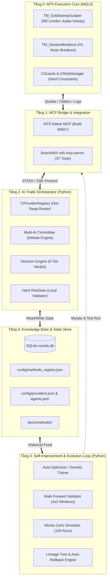

# SPEC_AI_TRADE_MODULE - AI Trade Orchestrator cho TM-EA
**Phiên bản:** 1.1 | **Ngày cập nhật:** 2026-11-19  
**Môi trường:** Python 3.11+ / MT5 Build 6060+ / MT5 MCP Server  
**Mô hình:** Provider-Agnostic, Multi-Agent Committee, Self-Evolution Loop, Hard RiskGate  
**Trạng thái:** Đặc tả kỹ thuật chuẩn hóa (Approved Specification)

---

## 0. NGUYÊN TẮC BẤT BIẾN (CORE INVARIANTS)

1. **Safety Layer Frozen (Tầng an toàn đóng băng tuyệt đối):**
   - AI **KHÔNG BAO GIỜ** được can thiệp, nới lỏng hay override các rào chắn rủi ro cốt lõi: `% Risk tối đa / lệnh`, `Stop Loss bắt buộc`, `Daily Loss Circuit Breaker`, `Max Drawdown Breaker` và `Spread Filter`.
   - Tầng bảo vệ này được mã hóa cứng (hardcoded) ở cấp MQL5 (`CGuards`, `CRiskManager`) và cấp Python (`RiskGate`).
2. **Deterministic & Reproducible (Minh bạch & Tái lập được):**
   - Mọi quyết định từ chối vào lệnh hoặc phê duyệt lệnh của AI đều phải lưu vết JSON schema đầy đủ: Prompt snapshot, Model ID, Token cost, Reasoning chain, Điểm tin cậy (Confidence score).
3. **Demo First, Vốn Thật Sau:**
   - Cơ chế tự tiến hóa (Self-Evolution Loop) chỉ được phép chạy trên môi trường giả lập (Strategy Tester) và tài khoản **Demo Cent** tối thiểu 4–8 tuần trước khi xem xét cho tài khoản thật.
4. **Tối đa hóa tái sử dụng mã nguồn mở:**
   - Ưu tiên tích hợp các chuẩn MCP và framework multi-agent đã qua kiểm chứng (xem Mục 8) thay vì viết lại từ đầu.

---

## 1. KIẾN TRÚC 5 TẦNG CHUẨN HÓA (5-LAYER ARCHITECTURE)



### Chi tiết phân tầng:

| Tầng | Tên tầng | Công nghệ | Nhiệm vụ chính |
|---|---|---|---|
| **Layer 0** | **MT5 Execution Core** | MQL5 (Expert Advisors) | Sinh tín hiệu kỹ thuật cơ sở (`TM_SessionBreakout`, `TM_GoldSweepScalper`), quản lý rủi ro tick-level, trailing stop và thực thi lệnh qua broker. |
| **Layer 1** | **MCP Bridge Gateway** | Python / Rust / SSE | Kết nối hai chiều giữa MT5 và AI: Lấy dữ liệu giá/tin/lịch kinh tế, gọi compile MetaEditor, điều khiển Strategy Tester. |
| **Layer 2** | **AI Trade Orchestrator** | Python 3.11+ / Asyncio | Điều phối các mô hình AI: Định tuyến provider, tổ chức tranh luận đa tác tử (Multi-Agent Committee), chấm điểm và kiểm duyệt rủi ro qua RiskGate. |
| **Layer 3** | **Knowledge & State Store** | SQLite / JSON / Markdown | Lưu trữ lịch sử giao dịch toàn diện (`results.db`), thư viện phương pháp giao dịch (`methods/`), bảng phả hệ tiến hóa (`lineage_tree.json`). |
| **Layer 4** | **Self-Improvement Loop** | Python / Scikit-learn / DEAP | Tự động đột biến tham số (Mutation Zone), kiểm định Walk-Forward OOS, mô phỏng Monte Carlo và tự động rollback khi hiệu suất suy giảm. |

---

## 2. QUẢN TRỊ PROVIDER & MODEL REGISTRY (HOT-SWAP & ROUTER)

Hệ thống hỗ trợ cơ chế **Hot-Swap** (thay đổi model thời gian thực không cần khởi động lại tiến trình) và **Multi-Provider Fallback**.

### 2.1 Cấu trúc file cấu hình Provider (`config/providers.json`)
```json
{
  "providers": {
    "google": {
      "enabled": true,
      "base_url": "https://generativelanguage.googleapis.com/v1beta",
      "api_key_env": "GEMINI_API_KEY",
      "models": ["gemini-2.5-pro", "gemini-2.5-flash"],
      "rate_limit_rpm": 60,
      "cost_per_1m_input": 0.125,
      "cost_per_1m_output": 0.375
    },
    "deepseek": {
      "enabled": true,
      "base_url": "https://api.deepseek.com/v1",
      "api_key_env": "DEEPSEEK_API_KEY",
      "models": ["deepseek-chat", "deepseek-reasoner"],
      "rate_limit_rpm": 60,
      "cost_per_1m_input": 0.14,
      "cost_per_1m_output": 0.28
    },
    "openai": {
      "enabled": true,
      "base_url": "https://api.openai.com/v1",
      "api_key_env": "OPENAI_API_KEY",
      "models": ["gpt-4o", "gpt-4o-mini"],
      "rate_limit_rpm": 100,
      "cost_per_1m_input": 2.50,
      "cost_per_1m_output": 10.00
    },
    "ollama_local": {
      "enabled": false,
      "base_url": "http://localhost:11434/v1",
      "api_key_env": "NONE",
      "models": ["qwen2.5:14b", "deepseek-r1:8b"],
      "rate_limit_rpm": 9999,
      "cost_per_1m_input": 0.0,
      "cost_per_1m_output": 0.0
    }
  }
}
```

### 2.2 Phân bổ vai trò tác tử (`config/agents.json`)
```json
{
  "agent_roles": {
    "technical_specialist": {
      "provider": "deepseek",
      "model": "deepseek-chat",
      "temperature": 0.2
    },
    "news_sentiment_specialist": {
      "provider": "google",
      "model": "gemini-2.5-flash",
      "temperature": 0.3
    },
    "risk_volatility_specialist": {
      "provider": "deepseek",
      "model": "deepseek-chat",
      "temperature": 0.1
    },
    "bull_advocate": {
      "provider": "google",
      "model": "gemini-2.5-flash",
      "temperature": 0.5
    },
    "bear_advocate": {
      "provider": "google",
      "model": "gemini-2.5-flash",
      "temperature": 0.5
    },
    "committee_chair": {
      "provider": "deepseek",
      "model": "deepseek-reasoner",
      "temperature": 0.2
    },
    "hard_validator": {
      "provider": "rule_based_engine",
      "model": "local",
      "temperature": 0.0
    }
  }
}
```

---

## 3. HỘI ĐỒNG AI TRANH LUẬN ĐA TÁC TỬ (MULTI-AI COMMITTEE)

Lấy cảm hứng từ cấu trúc phân xử đa tầng của `TradingAgents` và `goldfxgraph`, quy trình ra quyết định diễn ra qua **2 vòng tranh luận độc lập**:

```
[EA Signal / Market Data]
        │
        ▼
[3 Specialist Agents (Chạy song song, độc lập)]
  ├── Technical Analyst (Chart, S/R, Sweep, Regime)
  ├── News & Sentiment (Tin tức, Lịch kinh tế, Geopolitics)
  └── Volatility & Risk (ATR, Spread, Kill-zone status)
        │
        ▼
  [Gói Bằng Chứng Chuẩn Hóa - Evidence Package (JSON)]
        │
        ├─────────────────────────────┐
        ▼                             ▼
  [Bull Advocate]              [Bear Advocate]
  (Mở luận cứ Mua)            (Mở luận cứ Bán)
        │                             │
        └──────────────┬──────────────┘
                       ▼
          [Vòng 2: Phản biện chéo đối đầu]
                       │
                       ▼
          [Committee Chair / Arbitrator]
          (Chấm điểm, tổng hợp, ra quyết định 5 bậc)
                       │
                       ▼
          [Hard RiskGate / Validator]
          (Kiểm duyệt quy tắc an toàn cứng)
                       │
                       ▼
         [Lệnh gửi tới MT5 Bridge / Terminal]
```

### 3.1 Thang Quyết Định 5 Bậc (5-Tier Verdict System)
1. **STRONG_BUY / BUY**: Xác suất thắng cao, các chuyên gia đồng thuận thuận xu hướng -> Khuyến nghị vào 100% Risk allocation.
2. **OVERWEIGHT**: Tín hiệu tốt nhưng có yếu tố rủi ro nhỏ (ví dụ sắp có tin cấp 2) -> Khuyến nghị giảm volume còn 50–70% Risk allocation.
3. **HOLD / NEUTRAL**: Tranh luận cân bằng hoặc xuất hiện mâu thuẫn lớn giữa kỹ thuật và tin tức -> **HỦY TÍN HIỆU, KHÔNG VÀO LỆNH**.
4. **UNDERWEIGHT**: Tín hiệu bán yếu hoặc ngược xu hướng -> Giảm volume còn 50% hoặc hủy.
5. **STRONG_SELL / SELL**: Xác suất đảo chiều giảm cao -> Khuyến nghị vào 100% Sell Risk allocation.

### 3.2 Output Schema Chuẩn Hóa của Hội Đồng (JSON Contract)
```json
{
  "timestamp": "2026-11-19T14:30:00Z",
  "symbol": "XAUUSDm",
  "source_setup": "SweepReversal_M5",
  "verdict": "BUY",
  "confidence_score": 0.82,
  "execution_params": {
    "entry_price": 2650.50,
    "stop_loss": 2642.00,
    "take_profit": 2676.00,
    "suggested_risk_mult": 0.75
  },
  "committee_summary": {
    "technical_verdict": "Bullish liquidity sweep below Asia Low + reclaimed",
    "news_sentiment": "US Dollar index softening ahead of NY open",
    "risk_metrics": "Spread 28 points, ATR(M5) 3.2, inside London Kill-Zone",
    "bull_case_strength": 0.85,
    "bear_case_strength": 0.40,
    "chair_reasoning": "Strong confluence between technical reclaim and dollar weakness. Spread is low. Passed with 0.75x risk size."
  },
  "validation_result": {
    "passed": true,
    "adjusted": false,
    "reason": "RiskGate verified: SL within max allowable distance, risk < 1% cap"
  }
}
```

---

## 4. KHO PHƯƠNG PHÁP & CƠ SỞ DỮ LIỆU (METHOD REPOSITORY & RESULTS DB)

### 4.1 Cấu trúc kho phương pháp (`docs/methods/`)
Mỗi phương pháp giao dịch được quản lý dưới dạng một module độc lập:
```
docs/methods/
├── METHOD_001_ASIAN_BREAKOUT/
│   ├── SPEC.md
│   ├── params_baseline.json
│   └── validation_history.md
├── METHOD_002_JUDAS_SWEEP/
│   ├── SPEC.md
│   ├── params_baseline.json
│   └── validation_history.md
└── METHOD_003_ORB_M15/
    ├── SPEC.md
    └── params_baseline.json
```

### 4.2 Lược đồ Cơ sở Dữ liệu (`data/results.db` - SQLite)
```sql
CREATE TABLE IF NOT EXISTS trade_decisions (
    id INTEGER PRIMARY KEY AUTOINCREMENT,
    timestamp TEXT NOT NULL,
    symbol TEXT NOT NULL,
    method_id TEXT NOT NULL,
    direction TEXT NOT NULL,
    entry_price REAL NOT NULL,
    stop_loss REAL NOT NULL,
    take_profit REAL NOT NULL,
    risk_percent REAL NOT NULL,
    verdict TEXT NOT NULL,
    confidence REAL NOT NULL,
    chair_reasoning TEXT NOT NULL,
    model_version TEXT NOT NULL
);

CREATE TABLE IF NOT EXISTS trade_outcomes (
    id INTEGER PRIMARY KEY AUTOINCREMENT,
    decision_id INTEGER NOT NULL,
    ticket INTEGER NOT NULL,
    close_time TEXT NOT NULL,
    close_price REAL NOT NULL,
    pnl_usd REAL NOT NULL,
    r_multiple REAL NOT NULL,
    outcome TEXT CHECK(outcome IN ('WIN', 'LOSS', 'BREAKEVEN')),
    spread_paid REAL NOT NULL,
    commission_paid REAL NOT NULL,
    FOREIGN KEY(decision_id) REFERENCES trade_decisions(id)
);
```

---

## 5. VÒNG LẶP TỰ TIẾN HÓA & TỐI ƯU (SELF-TRAINING & LINEAGE)

Cơ chế tự tiến hóa được xây dựng dựa trên nguyên mẫu `ai-quant-reserch` và `AI-Quant-Strategy-Lab`:

```
1. Chọn baseline từ methods_registry (Round-robin hoặc theo PF gần nhất)
         │
         ▼
2. AI đọc Knowledge Base + Kết quả kiểm thử gần nhất
         │
         ▼
3. Đột biến mã nguồn CHỈ TRONG "AI MUTATION ZONE" (Code an toàn đóng băng)
         │
         ▼
4. Biên dịch qua MetaEditor MCP Bridge (Nếu lỗi -> AI sửa tối đa 3 lần)
         │
         ▼
5. Chạy Genetic Optimization trên MT5 Tester (Model=4 Real Ticks)
         │
         ▼
6. Kiểm định Out-Of-Sample: Walk-Forward (4 windows x 2) & Monte Carlo (100 runs)
         │
         ▼
7. Chấm điểm tổng hợp (Fitness Function):
   Fitness = (PF * 0.4) + (WinRate * 0.2) + ((100 - MaxDD) * 0.4)
         │
    ┌────┴─────────────────────────────┐
    ▼                                  ▼
[Regression > 10%]            [Đạt chuẩn cải tiến]
    │                                  │
    ▼                                  ▼
Tự động Rollback,             Đăng ký phiên bản mới vào
hủy bỏ biến thể               Lineage Tree -> Chạy Demo 4 tuần
```

### Quy tắc "AI Mutation Zone":
Trong mã nguồn Expert MQL5, chỉ các khối được đánh dấu tường minh mới được phép cho AI chỉnh sửa:
```mql5
// >>> AI_MUTATION_ZONE_START: SWEEP_FILTERS <<<
input double Sweep_Buffer_ATR = 0.75;
input double Sweep_RR = 3.0;
input int    Swing_Lookback = 25;
// >>> AI_MUTATION_ZONE_END: SWEEP_FILTERS <<<

// [FROZEN SAFETY CODE - STRICTLY READ-ONLY FOR AI]
if(spread > Max_Spread_Points) return false;
if(dailyLoss >= Max_Daily_Loss_Pct) return false;
```

---

## 6. TÍCH HỢP MT5 MCP BRIDGE & CÔNG CỤ

Hệ thống kết nối AI với MT5 thông qua 2 tầng cầu nối:
1. **MT5 Native MCP (Build 6060+):**
   - Cung cấp tương tác thời gian thực: Đọc dữ liệu tài khoản, lấy tick/nến giá, đọc tin tức lịch kinh tế, gọi MetaEditor compile file.
2. **Boschi404 MT5 MCP Server (Python Wrapper):**
   - Cung cấp các công cụ chạy ngầm tự động:
     - `run_mt5_backtest`: Điều khiển tester headless và xuất báo cáo CSV/HTML.
     - `run_mt5_optimization`: Chạy genetic optimization tham số.
     - `run_walk_forward`: Chia dữ liệu thành các cửa sổ In-Sample và Out-Of-Sample.
     - `run_monte_carlo`: Xáo trộn ngẫu nhiên thứ tự các lệnh để kiểm tra độ bền vốn.

---

## 7. TẦNG BẢO VỆ RISK GATE & CƠ CHẾ DẬP KHẨN CẤP (KILL-SWITCH)

RiskGate nằm ngay trước cổng gửi lệnh ra sàn. Bất kỳ lệnh nào vi phạm 1 trong các điều kiện sau sẽ bị từ chối ngay lập tức:
1. **Lệnh không có Stop Loss** -> REJECT 100%.
2. **Khoảng cách Stop Loss vượt quá mức chịu đựng rủi ro 1% tài khoản** -> REJECT hoặc tự động điều chỉnh giảm lot size (`suggested_risk_mult`).
3. **Spread hiện tại vượt quá `Max_Spread_Points`** -> REJECT.
4. **Tài khoản đang trong chuỗi thua cần làm nguội (Cooldown)** -> REJECT.
5. **Cơ chế Kill-Switch vật lý:** Nếu file `config/KILL` xuất hiện trong thư mục dự án, toàn bộ tiến trình AI Orchestrator lập tức ngắt kết nối, hủy mọi tác vụ và đóng toàn bộ vị thế mở.

---

## 8. DANH MỤC MÃ NGUỒN MỞ THAM KHẢO

| Dự án mã nguồn mở | Module sử dụng | Giấy phép |
|---|---|:---:|
| [MetaQuotes MT5 Native MCP](https://www.metatrader5.com/en/releasenotes/terminal/2447) | Nền tảng kết nối terminal, market data, metaeditor | Thương mại |
| [Boschi404/mt5-mcp-server](https://github.com/Boschi404/mt5-mcp-server) | 37 tools cho Backtest, Walk-Forward, Monte Carlo | MIT |
| [tusharrayamajhi/mt5-mcp-server](https://github.com/tusharrayamajhi/mt5-mcp-server) | Vòng lặp AI viết EA, tự compile, tự backtest | MIT |
| [TauricResearch/TradingAgents](https://github.com/TauricResearch/TradingAgents) | Kiến trúc Multi-Agent Debate 2 vòng | Apache-2.0 |
| [QuantiaAI/helm-agents](https://github.com/QuantiaAI/helm-agents) | 13-agent committee & Thang quyết định 5 bậc | MIT |
| [michael-chow-arch/goldfxgraph](https://github.com/michael-chow-arch/goldfxgraph) | Chuyên sâu XAU/USD, cơ chế Chair & Validator | MIT |
| [kishore828/ai-quant-reserch](https://github.com/kishore828/ai-quant-reserch) | Vòng lặp tự tiến hóa, lineage tree & auto-rollback | MIT |

---

## 9. LỘ TRÌNH TRIỂN KHAI 4 GIAI ĐOẠN

```
  [Phase 1: Foundation & Paper Mode] (Tuần 1 - 2)
    ├── Dựng cấu trúc Python orchestrator (ProviderRegistry, Agents, Multi-Agent Debate)
    ├── Kết nối MT5 MCP Server đọc dữ liệu thị trường
    └── Chạy Paper Mode trên 100 tín hiệu (So sánh quyết định AI vs Rule-based EA thuần)
                       │
                       ▼
  [Phase 2: RiskGate & Forward Demo Cent] (Tuần 3 - 4)
    ├── Đóng gói cứng tầng Hard RiskGate
    ├── Kích hoạt thực thi lệnh tự động trên Exness Demo Cent (5,000 USC)
    └── Thu thập dữ liệu vào SQLite results.db
                       │
                       ▼
  [Phase 3: Self-Evolution & Walk-Forward Engine] (Tuần 5 - 8)
    ├── Xây dựng vòng lặp tự động tối ưu qua Strategy Tester MCP
    ├── Triển khai bộ lọc Walk-Forward (4x2) và Monte Carlo
    └── Thiết lập Lineage Tree và cơ chế Auto-Rollback khi regression > 10%
                       │
                       ▼
  [Phase 4: Live Scaling & Portfolio Execution] (Tuần 9+)
    ├── Chỉ kích hoạt phương pháp vượt qua 8 tuần Demo có lãi dương
    └── Cấp vốn thật với tỷ lệ rủi ro thấp nhất (Risk multiplier 0.25x)
```
